# Machine Learning

## Setup

- Install the libraries once, then every example below runs without further setup.

```python
pip install -r requirements.txt
```

- The same imports open every notebook.

```python
import numpy as np
import pandas as pd
import matplotlib.pyplot as plt
import seaborn as sns
```

- `numpy` gives fast arrays and the mathematics that runs on them.
- `pandas` gives the table, called a DataFrame, the natural home for a dataset.
- `matplotlib` and its helper `pyplot` draw the charts.
- `seaborn` adds statistical plots on top of matplotlib.

- One small helper loads any dataset in the folder by name.

```python
from pathlib import Path

DATA = Path("Datasets")

def load(name):
    return pd.read_csv(DATA / name)
```

- With those lines every dataset is one call away, and every worked example below runs without further setup.

## What machine learning is

### The problem

- Some tasks are easy to state and impossible to code by hand.
- Take deciding whether a photograph shows a cat.
- A cat can be described in words, but the pixel by pixel rules that define one cannot be written down, because no such rules exist.
- The same is true of recognising speech, spotting spam, or predicting a house price from its size and location.
- Ordinary programming assumes every rule is supplied by hand, and these tasks break that assumption before any work begins.

### The idea

- Instead of writing the rules, supply examples and let the machine find the rules.
- A large set of past cases is provided, each with its inputs and the correct answer.
- An algorithm searches for a pattern that turns the inputs into the answer.
- The pattern it finds is a mathematical model.
- Once the model exists, a fresh case can be handed to it and a prediction returned.
- The quality of the model rises with the quantity and quality of the examples.
- This is the whole of machine learning in one paragraph: learn the rule from data rather than write the rule by hand.

### Worked example

- Consider telling a ripe mango from an unripe one.
- List the inputs a machine would need: colour, firmness, and smell.
- The answer to predict: ripe or not ripe.
- That list is a dataset waiting to be filled.
- It introduces the two words the rest of the course depends on, the features and the target.

### Where it fits

- Machine learning is not the same as artificial intelligence; it is one part of it.
- Artificial intelligence is the broad ambition of machines that behave intelligently.
- Machine learning is the subset where that behaviour is learned from data.
- Deep learning is in turn a subset of machine learning built on many layered networks.
- A short history gives the names a human context.
  - Alan Turing asked whether machines can think in 1950.
  - Arthur Samuel coined the phrase machine learning in 1959.
  - The field cooled during the so called AI winter of the late nineteen seventies.
  - It revived as computing grew.
  - Deep Blue beat the chess champion in 1997.
  - AlphaGo beat the Go champion in 2016.
- Today it runs quietly in the background of maps, assistants, and recommendations.

### Where this leads

- A model is learned from examples, but a model is not a finished product, and a single algorithm does not make one.
- Before anything can be predicted, data must be gathered and prepared, a model must be trained and tested, and the result must be deployed.
- That pipeline is the subject of the next section, because it is the frame into which every later algorithm is placed.

### Key questions

- Why can a task be easy to describe yet impossible to program by rule?
- What is the difference between artificial intelligence and machine learning?
- Name two everyday applications of machine learning and the data each would need.

## The life cycle of a model

### The problem

- A beginner believes the work is the algorithm.
- In practice the algorithm is a small part, and the surrounding workflow decides whether the project succeeds.
- If poor data is gathered, or the model is evaluated on the data it was trained on, the reported success vanishes the moment the model meets the real world.

### The idea

- The life cycle is a loop of seven stages.
- Data is gathered: from files, databases, or devices.
- It is prepared: put in one place and randomised.
- It is wrangled: cleaned of missing values, duplicates, and noise.
- It is analysed: the family of technique that fits the problem is chosen.
- The model is trained on a training set.
- It is tested on a held back test set.
- It is deployed into the real system, then watched to see whether it keeps performing.
- Each stage feeds the next, and a problem often sends the work back to an earlier one.

### Worked example

- The most important habit from this section is the split.
- The file is divided into a part to learn from and a part to judge on, and the two never overlap.

```python
from sklearn.model_selection import train_test_split

df = load("Data_2.csv")
X = df.iloc[:, :-1].values
y = df.iloc[:, -1].values

X_train, X_test, y_train, y_test = train_test_split(
    X, y, test_size=0.2, random_state=0)
```

### How to improve it

- The split ratio and the randomness are choices.
- A common ratio is eighty twenty.
- For small files, cross validation is preferred, because it rotates which part is held out so that every row is tested exactly once.
- A final test set is kept untouched until the very end, so the reported score stays honest.

### Where this leads

- The life cycle begins with data and features.
- Those words have been used freely, but what they are, how they are shaped, and where good ones come from has not yet been asked.
- The next section answers that, because everything downstream inherits the quality of these columns.

### Key questions

- Why must the test set be kept apart from training?
- What could go wrong if the data is not randomised before splitting?
- Where in the cycle would a failure after deployment point?

## Data, features, and the target

### The problem

- A model consumes numbers.
- Real tables contain words, dates, and gaps.
- Before any algorithm can run, every column must be understood and its type known.
- Otherwise the model is fed something it cannot use, and the reason for a bad result is misread.

### The idea

- A dataset is an organised collection of observations.
- In the tabular form used here, each row is one observation and each column is one variable.
- The variable to be predicted is the dependent variable, or target.
- The variables predicted from are the independent variables, or features.
- Features come in kinds.
  - Numerical: quantities, either continuous or discrete.
  - Categorical: labels.
  - Ordinal: ordered labels.
  - Binary: two values.
  - Date and time: can be split into parts.
  - Text and images: must be turned into numbers before use.
- The type decides which algorithms can accept the column and how it must be prepared.

### Worked example

- The small customer file shows the distinction.
- Features are sliced from the target three different ways.

```python
df = load("Data_2.csv")

X = df.iloc[:, :-1].values          # by position
X = df.loc[:, ["Country", "Age", "Salary"]].values   # by label
X = df[["Country", "Age", "Salary"]].values          # by name
y = df["Purchased"].values
```

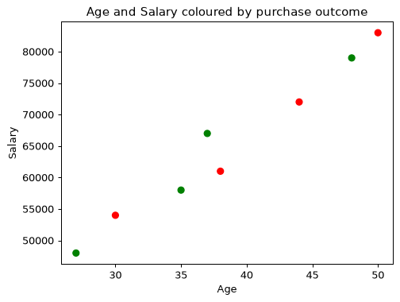

- The chart shows age against salary, with the purchase outcome as colour.
- The classes overlap, which is an early reminder that not every answer is visible in two columns, and that part of the work later is building better features.

### How to improve it

- Good data is often the difference between a working project and a stalled one, so it is worth knowing where data comes from.
- Kaggle and the UCI Machine Learning Repository host thousands of ready datasets.
- Cloud registries such as the AWS open data programme, Google dataset search, and government portals publish public data.
- Scikit-learn ships small built in datasets such as iris for practice.
- For a first project, a small, well understood file is always preferable, so that the effort goes into the method rather than into the mess.

### Where this leads

- Every column can now be named, but naming is not cleaning.
- The customer file has empty cells and a text column, and a model would refuse both.
- The next section turns such a table into something a model will accept.

### Key questions

- For a file predicting house price, name the target and three features and give each feature's type.
- Why must a feature matrix be two dimensional even with a single feature?
- Give one example each of a continuous and a discrete numerical feature.

## Preprocessing raw data

### The problem

- A real dataset arrives with gaps, duplicated rows, and columns of text.
- A model that expects a complete table of numbers will either crash or quietly learn the wrong thing.
- The customer file has two empty cells and a country column written in words.

### The idea

- Preprocessing is the set of repairs made before modelling.
- Missing values are filled, a process called imputation, usually with the mean or median of the column, or by a more careful method such as nearest neighbour imputation.
- Categorical columns are turned into numbers by encoding.
- There are two encodings, and the difference matters.
  - Label encoding gives each category an integer. Fine when the categories are ordered, because the order doubles as the rank. Misleading when they are not, because the model may think Germany is twice Spain.
  - One hot encoding gives each category its own zero or one column, so no false arithmetic is implied.
- One hot encoding has a trap: with three categories the three columns are not independent, since exactly one is one.
- This redundancy, called the dummy variable trap, is cured by dropping one column.

### Worked example

- The customer file is repaired step by step.

```python
df = load("Data_2.csv")
print(df.isna().sum())                 # see the gaps

df["Age"] = df["Age"].fillna(df["Age"].mean())
df["Salary"] = df["Salary"].fillna(df["Salary"].mean())

df["Country_encoded"] = pd.factorize(df["Country"])[0]   # label encoding
df = pd.get_dummies(df, columns=["Country"])            # one hot encoding
```

### How to improve it

- Beyond filling and encoding, the important cases are outliers and the choice of fill value.
- An outlier is a value so far from the rest that it drags a fit.
- The mean is distorted by outliers; the median resists them.
- A useful rule is to decide, for each gap, whether it is missing at random, in which case imputation is fine, or missing for a reason, in which case the fact that it is missing is itself a feature.

### Where this leads

- Cleaning makes a table usable, but usable is not the same as good.
- Two columns may carry the same information, and some columns may carry none.
- The next section is about choosing which columns deserve to exist, and about inventing new ones, and it is where accuracy is often won cheaply.

### Key questions

- Give one situation where label encoding is correct and one where it is dangerous.
- What is the dummy variable trap over?
- Why is the median often a safer fill value than the mean?

## Engineering and selecting features

### The problem

- A model with irrelevant features learns noise.
- A model with duplicate features cannot tell which of them is doing the work.
- Two variables that move together are collinear, and collinearity confuses the ranking of the features.
- There must be a way to keep the strong columns and drop the rest.

### The idea

- Correlation measures how well a straight line describes the relationship between two variables, on a scale from minus one to one.
  - Near one: they rise together.
  - Near minus one: one rises as the other falls.
  - Near zero: the straight line explains little.
- A column strongly correlated with the target is a promising feature.
- A pair of columns strongly correlated with each other is redundant, so one of the pair is kept.
- This is feature selection.
- Feature engineering goes further and constructs new columns using knowledge of the subject.
- A ratio, a combination, a date split into parts, or a continuous column grouped into bands can all create a signal that was not visible before.

### Worked example

- The iris dataset shows selection directly. Seaborn ships it, so no file is needed.

```python
iris = sns.load_dataset("iris")
iris["species"] = pd.factorize(iris["species"])[0]
corr = iris.corr()
sns.heatmap(corr, annot=True, cmap="coolwarm", fmt=".2f")
```

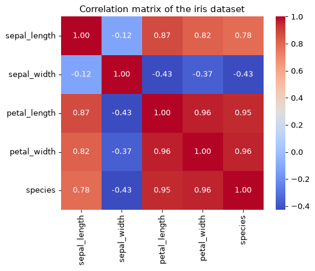

- In the last row, petal length correlates with the species at about 0.95 and petal width at about 0.96, while sepal width is negative and weak.
- Petal length and petal width also correlate with each other at about 0.96, so they are collinear and one of them is redundant.
- The conclusion is that the petal measurements dominate the problem.
- Features can also be constructed rather than selected.

```python
df["PE_Ratio"] = df["Stock_Price"] / df["Earnings_Per_Share"]
df["BMI"] = df["Weight"] / (df["Height"] ** 2)
df["Age_Group"] = pd.cut(df["Age"], bins=[0, 18, 35, 55, 100],
                         labels=["0-18", "19-35", "36-55", "56+"])
```

### How to improve it

- A logarithm reshapes a skewed column, compressing large values and spreading small ones, which helps models that assume a bell shape.

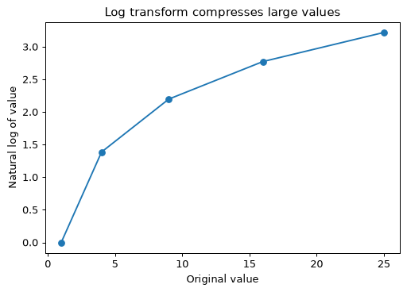

- One caution belongs here: engineering can go too far.
- Each new column is another chance to overfit, so a feature should be added only when there is a reason to believe it carries information, not merely because it is possible.

### Where this leads

- Selection and engineering decide which columns exist.
- They do not decide what scale those columns sit on.
- Two perfectly good features can sit on scales so different that one drowns the other.
- That is the constraint that forces the next section.

### Key questions

- A feature correlates 0.97 with the target and 0.96 with another feature. What should be done, and why?
- Give one engineered feature for a retail dataset and one for a health dataset.
- Why can adding features make a model worse?

## Scaling features

### The problem

- Age runs from about eighteen to sixty, and salary from twenty thousand to a hundred thousand.
- Methods that judge closeness by straight line distance will let salary decide every distance, because its numbers are thousands of times larger, and age will be ignored.
- The size of a column's numbers should not decide its importance.

### The idea

- Scaling puts every feature on a comparable footing.
- Standardization subtracts the mean and divides by the standard deviation, so the column has mean zero and standard deviation one, keeping its shape, centring it, and using units of standard deviations.

$$z = \frac{x - \mu}{\sigma}$$

- Min max scaling subtracts the smallest value and divides by the range, so every value lands between zero and one, which is simple but sensitive to outliers because one extreme value sets the range.

$$x' = \frac{x - \min(X)}{\max(X) - \min(X)}$$

- Mean normalization subtracts the mean and divides by the range, which centres the data near zero while keeping a bounded spread.

$$x' = \frac{x - \text{mean}(X)}{\max(X) - \min(X)}$$

### Worked example

- All three are applied to one small feature.

```python
from sklearn.preprocessing import StandardScaler

f = pd.Series([1, 3, 5, 7, 9], dtype=float)
print((f - f.mean()) / f.std())          # standardized
print((f - f.min()) / (f.max() - f.min()))   # min-max
print((f - f.mean()) / (f.max() - f.min()))  # mean-normalized
```

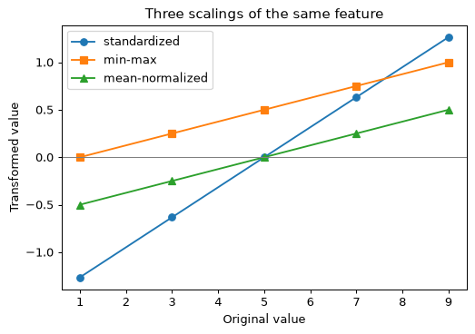

- The feature's ends land at about minus and plus 1.26 under standardization, at zero and one under min max, and at minus and plus one half under mean normalization.

### How to improve it

- The choice of scaling follows the model.
- Distance based methods such as K nearest neighbours and support vector machines need standardization.
- Bounded inputs such as image intensities are often min max scaled.
- Trees do not care about scale at all.
- One rule is absolute: the scaler is fitted on the training data only, then applied to the test data, never the other way around.

### Where this leads

- The groundwork is finished.
- There are clean, scaled, chosen features and a clear target.
- Now the central question appears, and it is the branch on which the whole course turns: is the answer known for every row, or not?
- If it is, this is supervised learning, and the nature of that answer will decide everything that follows.

### Key questions

- Why must the scaler be fitted on the training set only?
- Which of standardization and min max scaling is preferable for a column with severe outliers, and why?
- Why do decision trees not need scaling?

## Supervised learning and its fork

### The problem

- Suppose a table already carries, in every row, the answer to be predicted.
- The table could be memorised, but that is useless for new rows.
- The model must find a rule that generalises.
- The shape of the answer decides which rule can even be looked for.

### The idea

- Supervised learning is learning from labelled data.
- Each training row pairs inputs with the correct output.
- The model's job is to find the mapping from inputs to output.
- The word supervised is deliberate: every labelled row carries the correct answer, and the model is checked against it.
- The crucial observation, and the fork of the whole course, is that the nature of the output decides the family.
  - Output is a number on a continuous scale (a price, a temperature): regression.
  - Output is a category (yes or no): classification.
- The two families use different algorithms and, just as importantly, different ways of measuring success.

### Worked example

- The fork becomes concrete with a single table.
- The weather file holds a humidity column and a rain tomorrow column.
- Predicting humidity is regression, because humidity is a number.
- Predicting rain tomorrow is classification, because the answer is a category.

```python
df = load("Logistic_Regression_weatherAlbury.csv")
print(df[["Humidity3pm", "RainTomorrow"]].head())
```

### How to improve it

- The fork is not about the algorithms, which can sometimes be pressed into either role, but about the target and the metric.
- Regression is judged by how far predictions miss.
- Classification is judged by how often the class is right.
- Confusing the two leads to nonsense such as reporting an average error for a yes no prediction, and this is one of the most common mistakes.

### Where this leads

- The regression branch comes first, because it is the gentler introduction and its mathematics prepares the classification branch.
- To predict a quantity, a model of the relationship is needed, and the simplest such model is a straight line.
- Before fitting one, it must be said what makes a line good, which is the idea of a cost.

### Key questions

- What single feature of the target decides regression or classification?
- Give one regression and one classification question from a hospital dataset.
- Why do the two families need different metrics?

## Regression analysis and the cost of a line

### The problem

- We want to predict a continuous value, such as salary from experience.
- Many straight lines could be drawn through a scatter of points, and they would give different predictions.
- A definition of the best line is needed, so that the choice is not a matter of taste.

### The idea

- Regression models the relationship between a dependent variable and one or more independent variables.
- The simplest case links one feature to the target by a straight line, with an intercept and a slope.

$$y = a_0 + a_1 x + \varepsilon$$

- The intercept is where the line meets the vertical axis.
- The slope says how much the target changes for each unit of the feature.
- The small error term stands for the variation no line can capture.
- To choose the best line, a cost is defined, and the natural cost is the total squared vertical distance from the points to the line.
- Squared rather than absolute so that large misses are punished more than small ones, and so that the mathematics stays smooth and solvable.
- Fitting the model means choosing the intercept and slope that make this cost as small as possible.

### Worked example

- Take three points and two candidate lines and ask which line the cost prefers.
- Computing one round of squared errors shows the idea before the machinery arrives.

### How to improve it

- The names of the things that ruin a regression are worth fixing before they appear.
- An outlier is a point far from the rest, which can tilt the line.
- Multicollinearity is a strong correlation among the features, which muddles the slopes.
- Underfitting: the model is too simple to capture the pattern.
- Overfitting: the model memorises the training data and fails on anything new.

### Where this leads

- The definition of the best line is in hand.
- What remains is to find it, and to check it on data the model has not seen.
- That is the practice of simple linear regression.

### Key questions

- Why is the cost squared rather than taken as absolute values?
- What does the slope of a regression line mean in words?
- Define underfitting and overfitting in one sentence each.

## Simple linear regression

### The problem

- With one feature and a continuous target, we want the line that best predicts the target, and we want to trust it on new data.

### The idea

- Simple linear regression fits the line defined in the previous section, using the same cost, but now the computer does the minimising.
- Because a line can be thrown off by seeing the same data twice, the file is split first.
- The line is learned from the training part only, then drawn over both parts to see whether it holds.

### Worked example

- The salary file pairs years of experience with salary.

```python
from sklearn.model_selection import train_test_split
from sklearn.linear_model import LinearRegression

df = load("Linear_Regression_Salary_Data.csv")
X = df.iloc[:, :-1].values
y = df.iloc[:, 1].values

X_train, X_test, y_train, y_test = train_test_split(
    X, y, test_size=0.2, random_state=0)

regressor = LinearRegression()
regressor.fit(X_train, y_train)
```

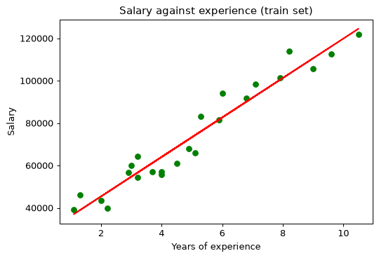

- The training points, in green, sit close to the red line.
- To check that the line generalises, it is drawn over the test points the model never saw.

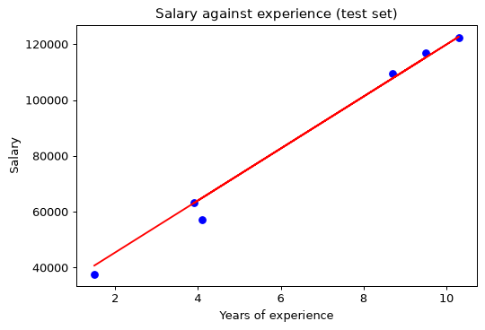

- The fit is just as close on the test set, which tells us the model learned a real relationship rather than memorising.

```python
regressor.predict([[3.5]])   # about 59374 for three and a half years
```

- The double brackets are not a typo: a model always expects a table of rows even for a single row.

### How to improve it

- The same method applies to any pair of quantities.
- The weather file pairs temperature with humidity.

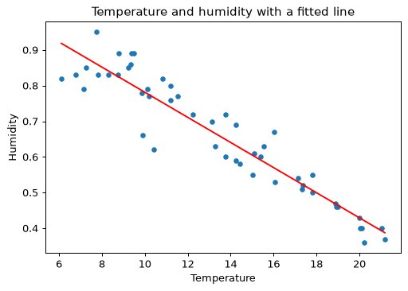

- The line is gentler here, which is itself informative, because it tells us the relationship is real but looser.

### Where this leads

- The line is drawn, but it has been judged by eye.
- Eye is not a measurement.
- To compare two models, or to defend a model to anyone else, numbers are needed, and the next section supplies the scores that judge a regression.

### Key questions

- Why is the data split before fitting?
- Sketch, in words, what a positive slope and a negative slope each mean.
- Predict, without running code, what the model should return for a year of experience far outside the training range, and whether that prediction is trustworthy.

## Judging a regression

### The problem

- Two models can both draw a line, and one is better.
- A number is needed that says how good, and different numbers emphasise different things, so the one that matches the question must be chosen.

### The idea

- Four scores cover most needs.
- Mean absolute error (MAE) averages the size of the misses and treats every miss equally.

$$\text{MAE} = \frac{1}{n}\sum |y_i - \hat{y}_i|$$

- Mean squared error (MSE) squares each miss before averaging, so it punishes large errors hardest, and it is preferred when big mistakes are especially costly.

$$\text{MSE} = \frac{1}{n}\sum (y_i - \hat{y}_i)^2$$

- Root mean squared error (RMSE) takes the square root of the mean squared error, returning the result to the units of the target so it can be compared with the target's own size.

$$\text{RMSE} = \sqrt{\frac{1}{n}\sum (y_i - \hat{y}_i)^2}$$

- The coefficient of determination, written R squared, reports the fraction of the variation in the target that the model explains, from zero to one.

$$R^2 = 1 - \frac{\sum (y_i - \hat{y}_i)^2}{\sum (y_i - \bar{y})^2}$$

### Worked example

- The salary model from the previous section is scored.

```python
from sklearn import metrics

y_pred = regressor.predict(X_test)
print("Mean salary:", df["Salary"].mean())
print("RMSE:", np.sqrt(metrics.mean_squared_error(y_test, y_pred)))
print("R2 (%):", regressor.score(X_test, y_test) * 100)
```

- The mean salary is about seventy six thousand.
- The RMSE is about three thousand five hundred and eighty.
- R squared is about ninety nine percent.
- A useful rule is that an RMSE comfortably below ten percent of the target's mean signals a strong fit, and here it is far below.

### How to improve it

- The reading matters as much as the computing.
- An R squared of 0.9 means ninety percent of the variation is explained.
- A high R squared does not prove that one variable causes another.
- It can be inflated by overfitting, so it should always be read beside an error score rather than instead of one.

### Where this leads

- One feature is rarely enough.
- When the target depends on several inputs, a single line ignores most of them.
- That is the constraint that pushes us to multiple linear regression.

### Key questions

- Which score would be reported if large errors are especially damaging, and why?
- A model has R squared 0.98. Is it necessarily a good model, and why not?
- If the RMSE is one percent of the target's mean, what does that tell you?

## Multiple linear regression

### The problem

- Profit, or house price, or humidity depends on many things at once.
- A model that uses one feature throws away the others.
- A model is needed that weighs several predictors together and tells us which matter most.

### The idea

- Multiple linear regression extends the line to many features, each with its own coefficient that says how much that feature moves the target while the others are held fixed.

$$y = a_0 + a_1 x_1 + a_2 x_2 + \dots + a_n x_n + \varepsilon$$

- The assumptions tighten.
- The relationship must be roughly linear.
- The features must not be badly collinear.
- The errors should be symmetric and bell shaped.
- The payoff is interpretability: the coefficients rank the features by their effect.

### Worked example

- The fifty companies file records what fifty startups spent on research, administration, and marketing, along with their state, and the profit each earned.
- State is a category, so it is encoded, and one dummy column is dropped to avoid the trap.

```python
from sklearn.preprocessing import LabelEncoder, OneHotEncoder
from sklearn.compose import ColumnTransformer

df = load("Multiple_Linear_Regression_50_CompList.csv")
X = df.iloc[:, :-1].values
y = df.iloc[:, 4].values

le = LabelEncoder()
X[:, 3] = le.fit_transform(X[:, 3])
ct = ColumnTransformer([("State", OneHotEncoder(), [3])], remainder="passthrough")
X = ct.fit_transform(X)
X = X[:, 1:]   # avoid the dummy variable trap

X_train, X_test, y_train, y_test = train_test_split(X, y, test_size=0.2, random_state=0)
regressor = LinearRegression().fit(X_train, y_train)
print("Test R2:", regressor.score(X_test, y_test))
```

- The test score is about 0.93.
- To rank the features, each numeric column is correlated with profit.

```python
print(df.corr(numeric_only=True)["Profit"])
```

- Research and development spend correlates with profit at about 0.97.
- Marketing correlates at about 0.75.
- Administration correlates at only about 0.20.
- One feature carries almost all the signal, and it returns in the section on reducing features.

### How to improve it

- Adding features is not automatically better.
- Each extra feature is another chance to overfit and another source of collinearity.
- A model with fewer, stronger features is easier to defend.

### Where this leads

- The straight line is now fitted to several features, but it is still straight.
- Some relationships curve, and a straight line through a curve is confidently wrong.
- That constraint is what the next section answers.

### Key questions

- What does a coefficient mean in a multiple regression?
- Why is one dummy column dropped?
- In the companies data, which feature would be kept if only one could be kept, and why?

## Polynomial regression

### The problem

- Some relationships are not straight.
- Salaries rise slowly through the junior levels and then leap at the top.
- A line misses that shape at exactly the part that matters, and reports a confident but wrong prediction.

### The idea

- Polynomial regression adds powers of the feature as extra columns, so the model can bend.

$$y = a_0 + a_1 x + a_2 x^2 + a_3 x^3 + \dots$$

- The name is confusing at first.
- The model is still linear in its coefficients, so it is a linear regression that happens to be fed curved features.
- The highest power is the degree, a value chosen rather than learned.
- Too small a degree underfits and misses the curve.
- Too large a degree overfits and wiggles through the noise.

### Worked example

- The position salaries file pairs a job level with a salary.

```python
from sklearn.preprocessing import PolynomialFeatures

pos = load("Polynomial_Regression_Position_Salaries.csv")
Xp = pos.iloc[:, 1:2].values
yp = pos.iloc[:, 2].values

poly = PolynomialFeatures(degree=2)
model = LinearRegression().fit(poly.fit_transform(Xp), yp)
```

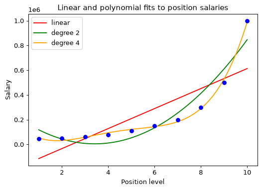

- The straight line misses the top of the curve, while the degree two and degree four curves follow the rise.
- The feature expansion is easy to show by hand: a value of six becomes a row of one, six, and thirty six, because the constant, the first power, and the square are now separate columns.

### How to improve it

- Higher degree is not better.
- The right degree is the smallest that captures the shape.
- It is found by trying a few and comparing their test scores, watching for the moment the score improves on training but stops improving on test, which is the signature of overfitting.
- Scaled features help here, because a large power of a large number overflows quickly.

### Where this leads

- The regression branch is finished.
- Every model here predicted a number.
- The moment the target becomes a category rather than a quantity, a straight line is the wrong tool, because it ranges over all numbers while the answer has only a few possible values.
- That constraint forces the fork, and the next section begins the classification branch.

### Key questions

- Why is polynomial regression still called linear regression?
- What happens to the model as the degree grows too large?
- Sketch, in words, why the degree two curve fits the top positions better than the line.

## Classification and its fork

### The problem

- Now the goal is to predict a category, such as whether a tumour is malignant or whether an email is spam.
- A regression line outputs arbitrary numbers, and passes through values that mean nothing for a category.
- A model is needed whose output is a class, and a way of judging whose class predictions are right.

### The idea

- Classification predicts which category an observation belongs to.
- Two categories: binary classification.
- More than two: multi class.
- Because accuracy alone can mislead, the confusion matrix records four counts for a binary problem.
  - True positives and true negatives: the model was right.
  - False positives and false negatives: the model was wrong.
- From these counts come precision, the share of positive predictions that were correct, and recall, the share of real positives that were found.

$$\text{Precision} = \frac{TP}{TP + FP} \qquad \text{Recall} = \frac{TP}{TP + FN}$$

### Worked example

- Consider a spam filter that flagged one hundred and ten messages, of which ninety were truly spam and twenty were not, while failing to catch thirty real spam messages.
- Precision is ninety over one hundred and ten, about 0.82.
- Recall is ninety over one hundred and twenty, about 0.75.
- Whether the filter should be tuned to favour one over the other depends on the cost of each kind of mistake, and that trade off is the heart of this section.

### How to improve it

- The remaining tools complete the picture.
- The F1 score balances precision and recall into one number when both matter.

$$F_1 = 2 \cdot \frac{\text{precision} \cdot \text{recall}}{\text{precision} + \text{recall}}$$

- The receiver operating characteristic (ROC) curve plots the true positive rate against the false positive rate as the threshold moves.
- The area under it summarises how well the model separates the classes at every threshold.
- Log loss scores the probabilities the model assigns and rewards confident, correct probabilities.

### Where this leads

- Every classification method must turn features into a class.
- The closest method to regression is the one that first predicts a probability and then applies a threshold.
- It is the natural first step, and it is where the branch begins.

### Key questions

- Compute precision and recall for a filter with one hundred and ten total positives predicted, ninety correct, and thirty real positives missed.
- Why is accuracy alone a poor measure on an unbalanced dataset?
- What does the area under the ROC curve summarise?

## Logistic regression

### The problem

- A probability between zero and one is wanted, but the linear model ranges over all real numbers.
- The straight line must be bent so that it can only produce values in the allowed range, while keeping the useful idea that some features push the answer up and others push it down.

### The idea

- Pass the linear value through the logistic function, also called the sigmoid, which squeezes any number into the range zero to one.

$$\sigma(z) = \frac{1}{1 + e^{-z}}, \qquad z = a_0 + a_1 x_1 + \dots + a_n x_n$$

- Large positive values of z push the output towards one.
- Large negative values push it towards zero.
- z of zero gives one half.
- A threshold, usually one half, turns the probability into a class.
- The coefficients now say how each feature shifts the likelihood of the yes class.

### Worked example

- The diabetes file records eight clinical measurements and whether each patient is diabetic.
- It has no header, so the columns are named.

```python
col_names = ["pregnant", "glucose", "bp", "skin", "insulin",
             "bmi", "pedigree", "age", "label"]
df = pd.read_csv(DATA / "Logistic_Regression_pima-indians-diabetes.csv",
                 header=None, names=col_names)

X = df[col_names[:-1]]
y = df["label"]
X_train, X_test, y_train, y_test = train_test_split(X, y, test_size=0.25, random_state=0)

from sklearn.linear_model import LogisticRegression
logreg = LogisticRegression(solver="lbfgs", max_iter=1000).fit(X_train, y_train)
print("Accuracy:", metrics.accuracy_score(y_test, logreg.predict(X_test)))
```

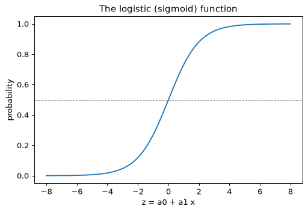

- The accuracy is about eighty percent.
- A single patient can be predicted in the same way as before.

```python
print(logreg.predict([[6, 148, 72, 35, 0, 33.6, 0.627, 50]]))
```

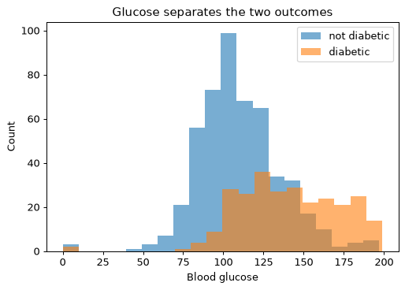

- The histogram explains why glucose carries the signal, since the diabetic readings sit higher than the rest.

### How to improve it

- There are three flavours.
  - Binomial: two classes.
  - Multinomial: several unordered classes.
  - Ordinal: ordered classes.
- The model assumes the classes are separated by a fairly simple boundary in the feature space.
- When that boundary is not simple, logistic regression underfits, and that is exactly the constraint the next method removes.

### Where this leads

- Logistic regression draws one smooth boundary across the whole feature space.
- Real problems sometimes have local structure, where the class depends on what the nearby examples look like rather than on a global rule.
- The next method follows that instinct literally.

### Key questions

- What does the sigmoid do to the value of z?
- Why does logistic regression give a probability rather than a plain class?
- Name the three types of logistic regression and give an example target for each.

## K nearest neighbours

### The problem

- A single global boundary may not fit the data.
- Sometimes the right answer depends on the neighbourhood of a point.
- Any attempt to summarise the whole space in one formula loses that local detail.

### The idea

- K nearest neighbours stores all the training data.
- To label a new point, it finds the k training points closest to it and lets them vote.
- There is no equation and no coefficients to learn, which is why it is called a lazy learner.
- The distance is usually the straight line, or Euclidean, distance.

$$d(p, q) = \sqrt{(p_1 - q_1)^2 + (p_2 - q_2)^2 + \dots + (p_n - q_n)^2}$$

### Worked example

- The customer file gives two features, age and salary, and a purchase outcome.

```python
from sklearn.preprocessing import StandardScaler
from sklearn.neighbors import KNeighborsClassifier

df = load("Naive_Bayes_Decision_RF_Tree_Boosting_User_Data.csv")
X = df.iloc[:, [2, 3]].values
y = df.iloc[:, 4].values
X_train, X_test, y_train, y_test = train_test_split(X, y, test_size=0.25, random_state=0)

scaler = StandardScaler()
X_train = scaler.fit_transform(X_train)
X_test = scaler.transform(X_test)

knn = KNeighborsClassifier(n_neighbors=5, metric="minkowski", p=2).fit(X_train, y_train)
print("Accuracy:", accuracy_score(y_test, knn.predict(X_test)))
```

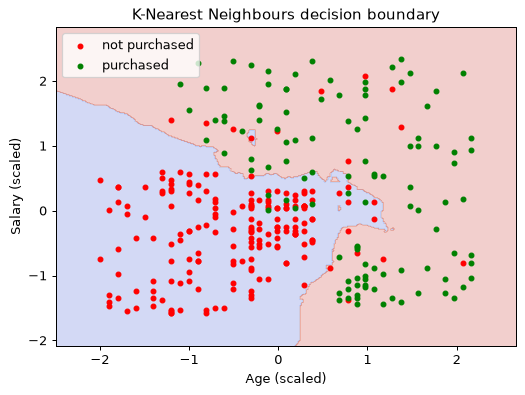

- The shaded regions show where each class is predicted.
- The accuracy is about ninety three percent, the highest so far.

### How to improve it

- The value of k is the main lever.
- A very small k is noisy and lets a single stray point decide.
- A very large k smooths away real detail.
- Five is a common starting point and an odd number avoids ties.
- The method is entirely built on distances, so scaling is not optional.
- Every prediction must compare the new point with every stored point, which grows slow as the data grows.
- That cost is paid on every single prediction, and it is the weakness the next method fixes.

### Where this leads

- K nearest neighbours is accurate but heavy, because it stores all the data and consults it every time.
- A single boundary that separates the classes as widely as possible would predict in one step and store far less.
- That is the idea of the next method.

### Key questions

- What does the value of k control?
- Why must the features be scaled before K nearest neighbours?
- Why is K nearest neighbours called a lazy learner?

## Support vector machines

### The problem

- Many boundaries can separate two classes, and most of them are fragile, sitting so close to the points that a new example could fall on the wrong side.
- The boundary that is as far as possible from both classes is wanted.

### The idea

- A support vector machine chooses the boundary that leaves the widest margin, the empty strip between the classes.
- In two dimensions that boundary is a line.
- The training points sitting on the edges of the strip are the support vectors, because they alone fix where the boundary lies.
- The rest could be removed without changing it.
- When the classes cannot be separated by a straight line, a kernel lets the machine work in a richer space where they can, without ever writing down the extra coordinates.

### Worked example

- On the same customer split, a linear support vector machine is fitted.

```python
from sklearn.svm import SVC

svm = SVC(kernel="linear", random_state=0).fit(X_train, y_train)
print("Accuracy:", accuracy_score(y_test, svm.predict(X_test)))
```

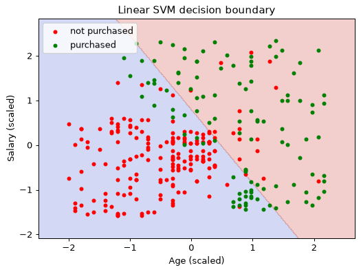

- The accuracy is about ninety percent.
- Comparing this boundary with the K nearest neighbours one shows how differently the two methods carve up the same space.

### How to improve it

- The kernel is the main lever.
  - A linear kernel draws a straight boundary.
  - A polynomial kernel a curved one.
  - A radial basis kernel a local one.
- The method can be tuned to the shape of the data.
- Like K nearest neighbours, it depends on distances, so scaling is required.
- One caution: support vector machines do not naturally return probabilities, only a decision, which is a limit the next method does not share.

### Where this leads

- There is a boundary, and it is the widest one, but the model speaks only in decisions, not in probabilities, and its reasoning is opaque.
- To reason about likelihoods directly, and to do it quickly from probabilities, a different route is needed, and the next method is built from probability from the ground up.

### Key questions

- What are support vectors and why do they matter?
- Why does a kernel allow a non linear boundary?
- Give one reason to prefer support vector machines over K nearest neighbours and one reason not to.

## Naive Bayes

### The problem

- Some classifiers give a decision but not a clear account of how confident they are or why.
- The goal is to classify by reasoning about probabilities, updating belief as evidence arrives, and to do it fast even when there are many features.

### The idea

- Bayes' theorem updates a belief in light of evidence.

$$P(A \mid B) = \frac{P(B \mid A) \, P(A)}{P(B)}$$

- P of A is the prior: what was believed before the evidence.
- P of B given A is the likelihood: how probable the evidence is if the belief is true.
- P of B is the overall probability of the evidence.
- The result is the posterior: the updated belief.
- The method is called naive because it assumes the features are independent, which is rarely exactly true but usually good enough.

### Worked example

- The classic weather example uses a small table of past days.
- Frequency counts are built, converted to likelihoods, and the theorem is applied to answer whether to play on a sunny day.
- The probability of playing is near 0.60 against about 0.41 for not playing, so the model plays.
- The Gaussian version is then fitted on the customer data.

```python
from sklearn.naive_bayes import GaussianNB

nb = GaussianNB().fit(X_train, y_train)
print("Accuracy:", accuracy_score(y_test, nb.predict(X_test)))
```

- The accuracy is about ninety percent.

### How to improve it

- The three variants fit the data's kind.
  - Gaussian: assumes each feature is a bell shape and suits continuous features.
  - Multinomial: uses word counts and suits text.
  - Bernoulli: uses presence or absence and also suits text.
- Naive Bayes is fast and works well with many features, which is why it is a favourite for spam filtering.
- Its independence assumption means it can be badly wrong when features are strongly related.

### Where this leads

- Naive Bayes assumes independence and produces a simple boundary.
- A decision tree makes a different trade: it makes no such assumption, and it explains its reasoning as a sequence of questions, which people find easy to follow.
- That interpretability is why it is the next method.

### Key questions

- Write Bayes' theorem and label each term.
- Why is the independence assumption called naive?
- For a spam filter counting how often each word appears, which variant fits, and why?

## Decision trees

### The problem

- Many models are hard to explain, and an answer no one can justify is hard to trust.
- A model is wanted whose reasoning is visible, one that anyone can follow from the inputs to the decision.

### The idea

- A decision tree asks a sequence of questions.
- Each internal node tests one feature.
- Each branch is the outcome of that test.
- Each leaf gives the class.
- The tree is grown by choosing, at each node, the question that best separates the classes.
- Two measures decide that.
- Entropy measures the disorder of the labels, highest when the classes are mixed and zero when a node is pure.

$$\text{Entropy}(S) = -p_{\text{yes}} \log_2 p_{\text{yes}} - p_{\text{no}} \log_2 p_{\text{no}}$$

- Information gain is the entropy before a split minus the weighted entropy after, and the tree prefers the feature with the largest gain.
- The Gini index is the alternative used by the CART algorithm, and it measures impurity without logarithms.

### Worked example

- A tree is fitted on the customer data, then a small one is grown so that its logic can be read.

```python
from sklearn.tree import DecisionTreeClassifier, plot_tree

dt = DecisionTreeClassifier(criterion="entropy", random_state=0).fit(X_train, y_train)
print("Accuracy:", accuracy_score(y_test, dt.predict(X_test)))

small = DecisionTreeClassifier(criterion="entropy", random_state=0,
                               max_depth=3).fit(X_train, y_train)
```

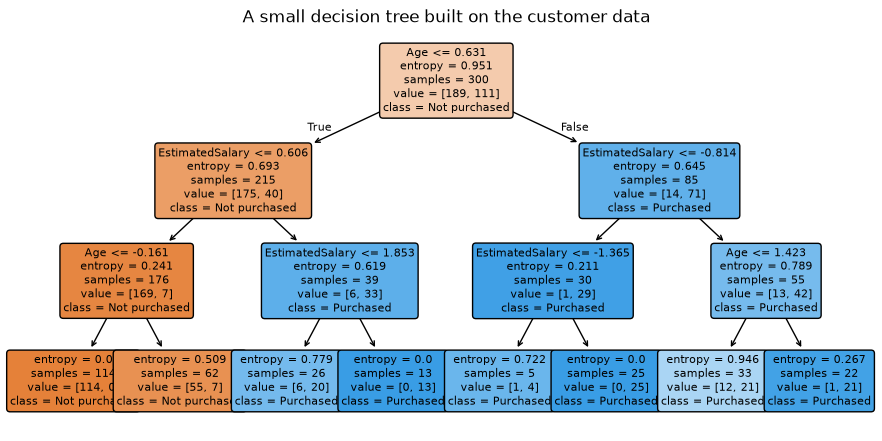

- The shallow tree asks about salary first, then about age, and reaches a decision within a few questions.
- This is the whole appeal of trees.

### How to improve it

- The levers are the criterion, entropy or Gini, and the depth, which controls overfitting.
- A tree grown without limit will memorise the training data and collapse on anything new.
- Pruning, cutting back the unwanted branches, is often necessary.
- The deeper weakness is instability.
- A small change in the data can produce a very different tree and a different accuracy.
- So a single tree is unreliable and cannot be trusted alone.
- That weakness is the constraint that opens the next section.

### Where this leads

- A single tree is easy to read but fragile.
- The cure is not to find a better tree but to stop relying on one tree at all, and to combine many.
- That is the idea of an ensemble.

### Key questions

- What does entropy measure?
- Why does a tree prefer the split with the largest information gain?
- Why is a single decision tree considered unreliable?

## Ensembles: forests and boosting

### The problem

- A single decision tree is unstable, and its accuracy changes with the data.
- The interpretability of trees is wanted without the fragility, and the accuracy must be steady.

### The idea

- An ensemble combines many models so that their errors cancel while their shared signal survives.
- Random forests use bagging.
  - Each tree is trained on a random sample of rows drawn with replacement.
  - At each split it may consider only a random subset of features, so the trees differ.
  - Their predictions are then voted or averaged.
- Boosting trains models in sequence, each one focusing on the examples the previous ones got wrong.
  - AdaBoost weights many small stumps, with more weight on the hard rows, and the final prediction is a weighted vote.
  - Gradient boosting fits each new tree to the remaining errors, the residuals, and adds it with a weight chosen to reduce the loss.
  - The name comes from following the slope of the loss downhill.
- XGBoost is a fast, well engineered form of gradient boosting.

### Worked example

- A forest and the two boosting models are fitted on the customer data.

```python
from sklearn.ensemble import RandomForestClassifier, AdaBoostClassifier, GradientBoostingClassifier

rf = RandomForestClassifier(n_estimators=10, criterion="entropy", random_state=0)
ada = AdaBoostClassifier(n_estimators=50, learning_rate=0.1, random_state=0)
gb = GradientBoostingClassifier(random_state=0)
for name, model in [("forest", rf), ("adaboost", ada), ("gradient", gb)]:
    model.fit(X_train, y_train)
    print(name, accuracy_score(y_test, model.predict(X_test)))
```

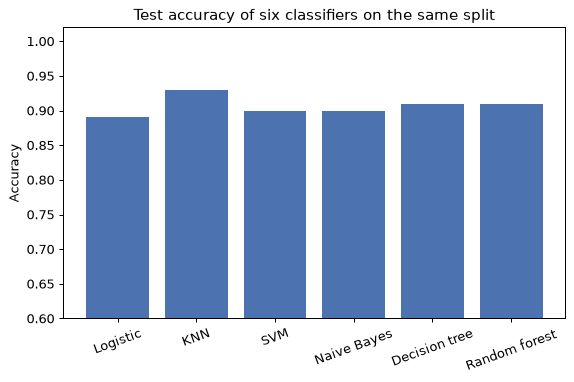

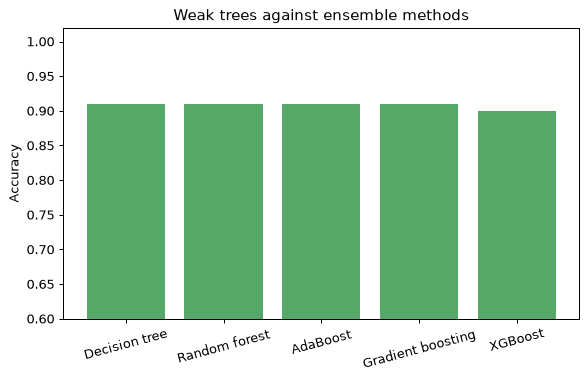

- On this easy problem the models cluster together.
- Once the signal is clear, many good methods find it, and the choice among them falls to speed, convenience, and how gracefully they handle messier data.

### How to improve it

- The main levers are the number of trees and, for boosting, the learning rate, which controls how much each new model is allowed to correct.
- A small learning rate with many trees is slower but often more accurate.
- The distinction between bagging and boosting is easy to confuse.
  - Bagging trains in parallel on different samples and averages.
  - Boosting trains in sequence on the mistakes and is more sensitive to noisy data.

### Where this leads

- There is now a rich toolbox of supervised models, but only two features in most examples.
- Real tables often have dozens or hundreds of columns, and too many features cause overfitting and collinearity.
- Before finishing supervised learning, they must be reduced, and that is the subject of the next section.

### Key questions

- What is the difference between bagging and boosting?
- Why do random forests resist overfitting better than a single tree?
- What does the learning rate control in boosting?

## Reducing features

### The problem

- More features are not better.
- Extra columns add complexity, invite overfitting, and create collinearity, and they make the model harder to explain.
- Principled ways are needed to keep only what earns its place, or to compress what is partly redundant.

### The idea

- Two methods answer two versions of the question.
- Backward elimination keeps the features that are statistically significant.
  - The model is fitted with all features.
  - Each one's p-value is read; it measures how likely an effect that large is under the assumption that the feature does nothing.
  - The feature with the largest p-value is removed if it exceeds a significance level such as 0.05.
  - The model is refitted, and the process repeats until every remaining feature is significant.
- Principal component analysis (PCA), by contrast, does not choose among the original features; it builds new ones.
  - It finds the directions along which the data varies most, called principal components, which are uncorrelated with each other.
  - It keeps the first few if they explain most of the variation.
  - The mathematics rests on eigenvalues and eigenvectors: the eigenvectors of the data's correlation matrix are the component directions, and the eigenvalues are how much variance each explains.

### Worked example

- Backward elimination is applied to the companies data.

```python
import statsmodels.api as sm

X_new = np.append(np.ones((50, 1)).astype(int), X, axis=1)
x_opt = X_new[:, [0, 1, 2, 3, 4, 5]].astype("float")
print(sm.OLS(endog=y, exog=x_opt).fit().summary())
```

- The column of ones carries the intercept.
- Reading the p-values, both state dummies fall away, then administration spend, then marketing spend, until only research and development spend remains.
- A model built on that single feature actually scores slightly higher, about 0.945 on the test set against 0.935 with all four features.
- PCA is then applied to the wine data, which has thirteen chemical measurements.

```python
from sklearn.decomposition import PCA
```

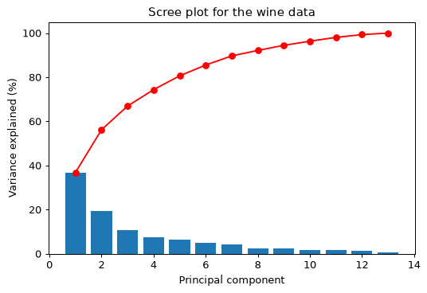

- The first component explains about thirty seven percent of the variance and the second about nineteen.
- Two together explain roughly fifty six percent.

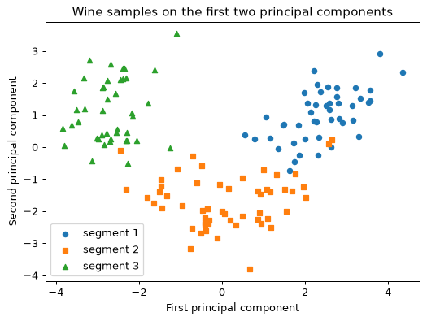

- With two components, a logistic regression still reaches about ninety seven percent accuracy, so two measurements do almost the work of thirteen.

### How to improve it

- The discipline is to reduce gradually.
- For PCA, halve the dimension, check the accuracy, then reduce further one step at a time, stopping when the accuracy becomes unacceptable, rather than jumping to a very small number and blaming the data.
- For backward elimination, p-values are only as trustworthy as the model's assumptions.

### Where this leads

- Everything so far has needed labels.
- Every model was taught with an answer key.
- But labels are expensive and often absent, and that single fact is the largest constraint in the field.
- When there is data but no answers, supervised learning has nothing to learn from, and the question itself must change.
- That is where the next section begins.

### Key questions

- What does a p-value tell you?
- Why does removing features sometimes improve accuracy?
- What does a principal component represent?

## Clustering without labels

### The problem

- There is a table of customers, but no column saying what kind of customer each one is.
- There is no answer key.
- Supervised learning cannot run, because it learns by comparing predictions with correct answers and there are none.
- Yet the data may still hold structure worth finding.

### The idea

- Clustering is unsupervised learning.
- It groups observations so that points within a group are similar and points in different groups are not, with no labels to guide it.
- This is the constraint that separates the two halves of the course.
  - Supervised learning maps inputs to known outputs.
  - Unsupervised learning finds structure in inputs alone.
- Hierarchical clustering, the bottom up variety, is the gentlest introduction.
  - It begins by treating every point as its own cluster and repeatedly merges the two closest.
  - It records every merge in a tree shaped diagram called a dendrogram.
  - The height at which two groups join is the distance at which they merged.
  - To choose the number of clusters, the dendrogram is cut horizontally, so that the branches below the cut are the clusters.
- What counts as the distance between clusters is set by a linkage rule.
  - Single: the closest pair.
  - Complete: the farthest pair.
  - Average: the average.
  - Ward's method: merges the pair that adds least to the total within cluster variance.

### Worked example

- The mall customers, whose annual income and spending score make a clear two dimensional picture, are used here.
- The missing rows are dropped first.

```python
import scipy.cluster.hierarchy as shc

df = load("Mall_Customers_Clustering.csv").dropna()
X = df.iloc[:, [3, 4]].values
shc.dendrogram(shc.linkage(X, method="ward"))
plt.show()
```

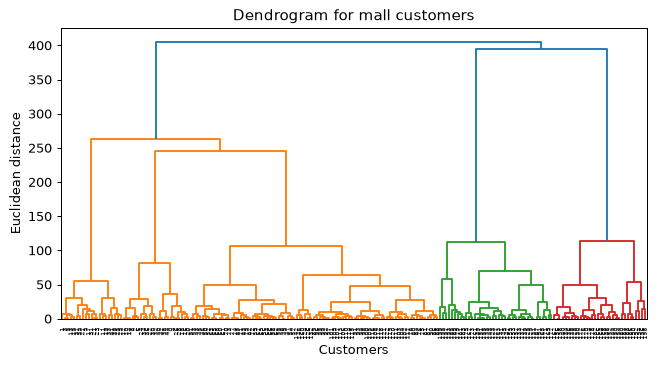

- The long vertical stretches should not be cut through.
- A horizontal cut across the longest vertical gap gives the clusters.
- This shows that clustering has no single right answer, only a defensible one.

### How to improve it

- The linkage method is the main lever, and different methods give different clusters, so trying more than one is worthwhile.
- The greatest advantage of hierarchical clustering is that no cluster count is fixed in advance, which is exactly the freedom the next method lacks.

### Where this leads

- Hierarchical clustering shows every possible number of clusters at once, and that is convenient but slow on large data.
- Often a single, fast method aimed at a chosen number of groups is wanted, which is the idea of K-means, and with it the new problem of choosing that number.

### Key questions

- Why can clustering run without labels when supervised learning cannot?
- What does the height in a dendrogram represent?
- What does a linkage rule decide?

## K-means and choosing the number of clusters

### The problem

- A fixed number of groups is wanted, but that number is not known, and different choices give different groupings.
- A fast method is needed to form the groups, and a principled way to choose how many.

### The idea

- K-means is a partitioning method.
- The number of clusters, K, is chosen.
- K centroids are placed.
- Every point is assigned to its nearest centroid.
- Each centroid is recomputed as the average of its points.
- The steps repeat until the assignments stop changing.
- The quantity it minimises is the within cluster sum of squares, the total squared distance from each point to its own centroid.

$$\text{WCSS} = \sum_{\text{clusters}} \sum_{\text{points}} \lVert p - c \rVert^2$$

- Because K must be chosen beforehand, the elbow method is used to find it.
  - K-means is fitted for a range of K.
  - The within cluster sum of squares is recorded each time and plotted against K.
  - The curve falls steeply and then flattens, and the bend, which looks like an elbow, is the natural number of clusters.

### Worked example

- The curve is computed, and then the final clusters.

```python
from sklearn.cluster import KMeans

wcss = []
for k in range(1, 11):
    km = KMeans(n_clusters=k, init="k-means++", random_state=42, n_init=10).fit(X)
    wcss.append(km.inertia_)
plt.plot(range(1, 11), wcss, "o-"); plt.show()
```

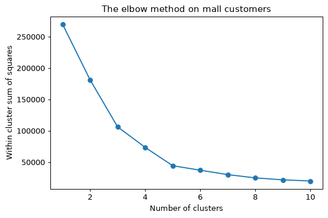

- The values fall from about two hundred and seventy thousand at one cluster to about twenty thousand at ten.
- The last steep drop is between four and five, so five is chosen.

```python
km = KMeans(n_clusters=5, init="k-means++", random_state=42, n_init=10)
labels = km.fit_predict(X)
```

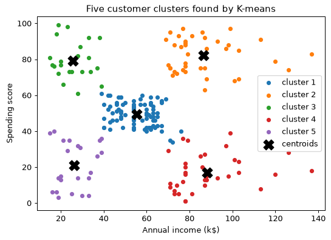

- The five groups are separated by income and spending, which is exactly the kind of segmentation a shop would act on.

### How to improve it

- The weaknesses are worth stating plainly.
- K-means prefers clusters that are round and of similar size, so it struggles with long or curved clusters.
- The result depends on where the centroids start, which is why the k-means plus plus initialisation is used.
- The elbow is a judgement, not a rule, so a slightly different K can be defensible.

### Where this leads

- Clustering groups rows by similarity.
- That answers one kind of question, but it cannot answer another, which is which items tend to appear together.
- A shopper buying bread is not asking to be grouped with other shoppers; the useful fact is that bread and butter travel together.
- That different question needs a different tool.

### Key questions

- What does K-means minimise?
- Why must K be chosen before the algorithm runs?
- What does the elbow in the WCSS curve indicate?

## Association rules

### The problem

- In a shop, grouping customers is not the goal.
- The goal is to know which products are bought together, so that they can be placed side by side or recommended one after the other.
- Rules are needed that link items, with a measure of how strong each rule is.

### The idea

- Association rule mining finds items that co occur in transactions and expresses the finding as a rule, such as bread implying butter.
- Three numbers judge a rule.
- Support is how often the items appear together across all transactions.

$$\text{support}(A) = \frac{\text{transactions containing } A}{\text{total transactions}}$$

- Confidence is the share of the antecedent's transactions that also contain the consequent.

$$\text{confidence}(A \to C) = \frac{\text{support}(A \cup C)}{\text{support}(A)}$$

- Lift compares the confidence with how often the consequent appears on its own.
- A lift above one means the antecedent genuinely makes the consequent more likely.
- The Apriori algorithm exploits a simple observation: if an item set is frequent then all of its subsets must be frequent.
- This lets it discard huge numbers of candidates instead of testing every combination.

### Worked example

- No transaction file ships with the course, so a small basket log is mined, which shows the whole procedure.

```python
from apyori import apriori

records = [["bread", "butter"],
           ["bread", "butter", "jam"],
           ["bread", "butter"],
           ["bread", "butter"],
           ["bread", "butter", "jam"],
           ["milk"]]

rules = list(apriori(records, min_support=0.3,
                     min_confidence=0.6, min_lift=1.1, min_length=2))
for rule in rules:
    print(list(rule.items), "support:", round(rule.support, 3))
```

- Bread and butter appear together in five of the six baskets, so the rule joining them clears every threshold and shows a lift above one.
- The pruning happens round by round, and the pruning, not the arithmetic, is the heart of the method.
  - Single items are counted and kept if frequent.
  - Frequent singles are combined into pairs, which are counted and kept if frequent.
  - Frequent pairs are combined into triples.
  - The process continues until no larger set survives.

### How to improve it

- The thresholds are the levers.
- Too high a support and nothing survives.
- Too low and the output floods with weak rules.
- Lift, not support or confidence alone, is the best guard against spurious rules, because it removes pairs that only co occur by chance.

### Where this leads

- Both supervised and unsupervised learning assume that the data already exists, gathered in advance.
- In many real situations it does not.
- A robot must act to gather its own experience, and it learns only from the rewards its actions earn.
- That different contract is the last topic of the course.

### Key questions

- Distinguish support from confidence in one sentence each.
- A rule has high confidence but a lift below one. What does that mean?
- Why does Apriori discard an item set as soon as a subset is infrequent?

## Reinforcement learning

### The problem

- Sometimes there is no dataset.
- A game playing program cannot be given a table of every position and the correct move, because the correct move depends on what happens next, which depends on the opponent.
- The program must act, observe the consequences, and improve from the results, without ever being told the right move.

### The idea

- Reinforcement learning is learning from feedback.
- An agent interacts with an environment, takes actions, and receives a reward for good actions and a penalty for bad ones.
- Its goal is to maximise the total reward over time.
- It explores the environment, learns which actions pay off in which situations, and improves its behaviour.
- This is the setting behind game playing programs and control systems such as a robot learning to walk.
- It differs from everything before it because the data is generated by the agent's own actions rather than gathered in advance.

### Worked example

- A game is the running example.
- Each position is a situation.
- Each legal move is an action.
- The reward is plus one for a win and minus one for a loss, perhaps only at the very end.
- That is what makes the problem hard, because the agent must work out which of its earlier moves deserve credit for the final result.
- That credit assignment problem is the heart of the topic, and naming it gives the right intuition even without the mathematics.

### How to improve it

- The main levers are how much the agent explores versus exploits what it already knows, and how it balances immediate reward against long term reward.
- Too much exploration wastes time.
- Too much exploitation misses better strategies.
- This tension runs through the whole field of reinforcement learning.

### Where this leads

- This closes the arc.
- The course began by asking whether rules can be learned rather than written, and it has now covered the three great contracts a learner can have: with labels, without labels, and with only rewards.
- Each was forced by the one before it, because each removed an assumption the earlier methods could not do without.

### Key questions

- Why is reinforcement learning not supervised, even when the agent receives feedback?
- What is the credit assignment problem?
- Give one example of exploration and one of exploitation in a board game.

## The shape of the whole course

- The whole course is one argument held together by constraints.
- Complex tasks could not be programmed by rule, so learning from data replaced the hand written rule.
- Data arrives dirty and on mixed scales, so it was cleaned and scaled.
- Too many or too few features hurt, so they were selected, engineered, and reduced.
- The first great branch followed from the target: a number meant regression, a category meant classification, and logistic regression was the hinge between them.
  - Within regression, the work moved from one feature to many to curves, each step forced by the previous model's limits.
  - Within classification, it moved from a global boundary to a local one, then to the widest margin, then to probabilities, then to questions, then to ensembles that cure a single tree's instability.
- The second great branch followed from the single largest constraint of all, the absence of labels.
  - It forced the move into clustering and association.
  - It finally reached reinforcement learning, where there is no dataset at all until the agent acts.
- Every section earned its place by naming a problem the previous tools could not solve.
- Kept visible, the constraints turn a list of algorithms into a single line of reasoning that keeps answering the question, what do we do when the last idea is not enough.
- Every figure in this document is drawn from the files in `Datasets`, and every model has a notebook beside it in the `notebooks` folder.
