# Machine Learning

The note can be run using simple python. Install the required libraries using the following command.

```bash
python -m venv .venv
```

```python
pip install -r requirements.txt
```

- `pip` is the python package manager
- `-r` reads 
- `requirements.txt` contains packages that are required to install

```python
import numpy as np
import pandas as pd
import matplotlib.pyplot as plt
import seaborn as sns
```

A single helper loads any dataset in the folder by name, which keeps the examples short and portable across machines.

```python
from pathlib import Path

DATA = Path("Datasets")

def load(name):
    return pd.read_csv(DATA / name)
```

## The data used for the examples

The examples lean on a small set of tables, each chosen so that a concept has somewhere natural to live. The customer file records a country, an age, and a salary for each person along with whether they purchased, which makes it useful for preprocessing and for the simplest classifiers. The salary file pairs years of experience with salary, and the weather files pair a measurement such as temperature with humidity. The companies file records what fifty startups spent on research, administration, and marketing, and the profit they earned. The diabetes file holds clinical measurements, the wine file holds thirteen chemical measurements, and the mall customers file holds an income and a spending score. Two of them need a word of warning up front: the diabetes file has no header row, so its columns are named by hand, and the mall file has a few missing rows, which are dropped before use.

| File | What it holds | Target |
| --- | --- | --- |
| Data_2.csv | country, age, salary, purchase outcome | Purchased |
| Linear_Regression_Salary_Data.csv | years of experience, salary | Salary |
| Linear_Regression_WeatherData.csv | temperature, humidity | Humidity |
| Multiple_Linear_Regression_50_CompList.csv | research, administration, marketing, state, profit | Profit |
| Polynomial_Regression_Position_Salaries.csv | position, level, salary | Salary |
| Logistic_Regression_pima-indians-diabetes.csv | clinical measurements | diabetic label |
| Logistic_Regression_weatherAlbury.csv | daily weather records | rain tomorrow |
| Naive_Bayes_Decision_RF_Tree_Boosting_User_Data.csv | age, estimated salary, purchase outcome | Purchased |
| PCA_Wine.csv | thirteen chemical measurements | customer segment |
| Mall_Customers_Clustering.csv | id, genre, age, income, spending score | none |

## What machine learning is

Some tasks are easy to describe and impossible to write down as rules. Deciding whether a photograph shows a cat is the standard example: a cat can be described in words, but the pixel by pixel rules that define one cannot be written, because no fixed rules exist. The same is true of recognising speech, filtering spam, or pricing a house from its size and location. Ordinary programming assumes that every rule is known in advance, and these tasks break that assumption before any work begins.

Machine learning replaces the hand written rule with one learned from examples. A large set of past cases is provided, each with its inputs and the correct answer, and an algorithm searches for a pattern that turns the inputs into the answer. That pattern is the model. Once it exists, a fresh case can be handed to it and a prediction returned. The more and the better the examples, the more reliable the model, which is why data is the raw material of the whole field.

It is worth separating the terms early, because they are often used as if they were the same. Artificial intelligence is the broad ambition of machines that behave intelligently. Machine learning is the part of it that learns behaviour from data, and deep learning is in turn a part of machine learning built from many layered networks. The idea is old: Alan Turing asked whether machines can think in 1950, Arthur Samuel coined the phrase machine learning in 1959, and after a quiet period in the late nineteen seventies the field returned, reaching milestones such as Deep Blue beating the chess champion in 1997 and AlphaGo beating the Go champion in 2016. Today it runs quietly behind maps, assistants, and recommendations.

A model learned from examples is not yet a finished product, and a single algorithm does not make one. Data has to be gathered and prepared, a model trained and tested, and the result deployed and watched. That surrounding loop is the next thing to understand, because every algorithm that follows is placed inside it.

## The life cycle of a model

A beginner tends to think the work is the algorithm. In practice the algorithm is a small part, and the surrounding workflow decides whether a project succeeds. Poor data, or a model judged on the very rows it was trained on, produces success that disappears the moment the model meets the real world.

The work moves through a loop. Data is gathered from files, databases, or devices. It is prepared, put in one place, and randomised so its order carries no accidental meaning. It is wrangled, cleaned of missing values, duplicates, and noise. It is studied, and the family of technique that fits the problem is chosen. The model is trained on one part of the data and tested on a part held back, and finally it is deployed and watched to see whether it keeps performing. A problem at any stage usually sends the work back to an earlier one.

The single most important habit in that loop is the split. The data is divided into a part to learn from and a part to judge on, and the two never overlap, because a model that has seen every row can always look accurate.

```python
from sklearn.model_selection import train_test_split

df = load("Data_2.csv")
X = df.iloc[:, :-1].values
y = df.iloc[:, -1].values

X_train, X_test, y_train, y_test = train_test_split(
    X, y, test_size=0.2, random_state=0)
```

Import scikit learning function for splitting. Then X is assigned all columns except the last one. Y is assigned to the last column that is the predicted value. `.values` converts the selection into the numpy array. 80:20 splitting of data, 20% go into testing and the rest 80% goes into testing.

For small files a plain split can waste data, and cross validation is preferred, because it rotates which part is held out so that every row is tested exactly once. A final test set is kept untouched until the very end, so the reported score stays honest.

The loop begins with data and features, words that have been used freely but not yet pinned down. Everything downstream inherits the quality of those columns, so the next thing to understand is what a table actually holds and how each column is shaped.

## Data, features, and the target

A dataset is an organised collection of observations. In the tabular form used here, each row is one observation and each column is one variable. The variable to be predicted is the dependent variable, or target, and the variables predicted from are the independent variables, or features. Features come in kinds, and the kind decides what can be done with the column. Numerical features are quantities, either continuous, such as height, or discrete, such as a count of children. Categorical features are labels, such as a country. Ordinal features are ordered labels, such as a satisfaction rating from poor to excellent. Binary features hold two values, and date and time features can be split into parts such as year, month, and weekday. Text and image features must be turned into numbers before any model can use them.

The small customer file makes the distinction concrete. The features are the country, age, and salary, and the target is whether the customer purchased. They can be sliced from the table in three equivalent ways, and knowing all three is useful because different codebases use different styles.

```python
df = load("Data_2.csv")

X = df.iloc[:, :-1].values          # by position
X = df.loc[:, ["Country", "Age", "Salary"]].values   # by label
X = df[["Country", "Age", "Salary"]].values          # by name
y = df["Purchased"].values
```

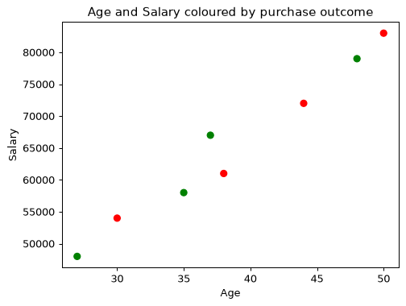

The chart plots age against salary with the purchase outcome as colour, and the two classes overlap heavily. That overlap is an early reminder that not every answer is visible in two columns, and that part of the work later is building better features.

Good data is often the difference between a working project and a stalled one, so it is worth knowing where it comes from. Kaggle and the UCI Machine Learning Repository host thousands of ready datasets, cloud registries such as the AWS open data programme publish public data, Google runs a dataset search, government portals release public records, and scikit-learn ships small built in datasets such as iris for practice. For a first project a small, well understood file is always preferable, so that the effort goes into the method rather than into the mess.

A column can be named and typed, but that is not the same as being usable. The customer file has empty cells and a column of text, and a model would refuse both, so the next step is to turn such a table into something a model will accept.

## Preprocessing raw data

A real dataset arrives with gaps, duplicated rows, and columns of words, and a model that expects a complete table of numbers will either crash or quietly learn the wrong thing. The customer file is a mild example: two cells are empty and the country column is text. Both have standard repairs.

Missing values are filled, a process called **imputation**, usually with the mean or the median of the column, or by a more careful method such as nearest neighbour imputation. Categorical columns are turned into numbers by encoding, and there are two encodings whose difference matters. Label encoding gives each category an integer, which is fine when the categories are ordered, because the order doubles as the rank, but misleading when they are not, because a model may read Germany as twice Spain. One hot encoding gives each category its own zero or one column, so no false arithmetic is implied. One hot encoding carries a subtlety: with three categories the three columns are not independent, since exactly one of them is one, and this redundancy, called the dummy variable trap, is cured by dropping one of the columns.

```python
df = load("Data_2.csv")
print(df.isna().sum())                 # see the gaps

df["Age"] = df["Age"].fillna(df["Age"].mean())
df["Salary"] = df["Salary"].fillna(df["Salary"].mean())

df["Country_encoded"] = pd.factorize(df["Country"])[0]   # label encoding
df = pd.get_dummies(df, columns=["Country"])            # one hot encoding
```

Two further points repay attention. An outlier is a value so far from the rest that it drags a fit, and the mean is distorted by outliers while the median resists them, so the median is often the safer fill. And a gap should be judged on why it is there: if it is missing at random, imputation is reasonable, but if it is missing for a reason, then the fact of its being missing is itself a feature worth recording.

Cleaning makes a table usable, which is not the same as making it good. Two columns may carry the same information, and some may carry none at all. Deciding which columns deserve to exist, and inventing better ones, is where accuracy is often won cheaply, so that is the next thing to look at.

## Feature engineering and selection

A model with irrelevant features learns noise, and a model with duplicate features cannot tell which of them is doing the work. Two variables that move together are called collinear, and collinearity confuses any attempt to rank the features by importance. There are two ways to respond: keep the strongest of the columns that already exist, and construct new ones that carry more signal.

Correlation measures how well a straight line describes the relationship between two variables, on a scale from minus one to one. **A value near one means they rise together, near minus one means one rises as the other falls, and near zero means the straight line explains little**. A column strongly correlated with the target is a promising feature, and a pair of columns strongly correlated with each other is redundant, so one of the pair is kept and the other dropped. This is feature selection. Feature engineering goes further and builds new columns from knowledge of the subject, which is often more valuable than any choice among the existing ones.

The iris dataset shows selection directly, and Seaborn ships it, so no file is needed.

```python
iris = sns.load_dataset("iris")
iris["species"] = pd.factorize(iris["species"])[0]
corr = iris.corr()
sns.heatmap(corr, annot=True, cmap="coolwarm", fmt=".2f")
```

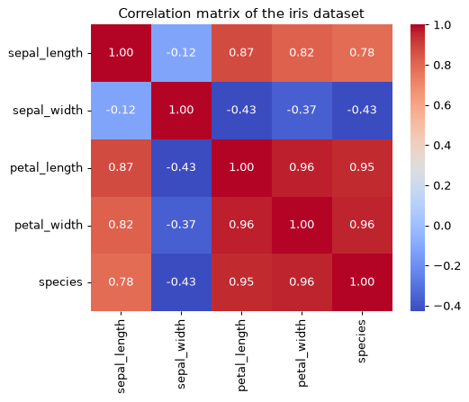

Reading the last row, petal length correlates with the species at about 0.95 and petal width at about 0.96, while sepal width is negative and weak. Petal length and petal width also correlate with each other at about 0.96, so they are collinear and one of them is redundant. The petal measurements clearly dominate the problem. Constructing features works the other way, building a column that did not exist.

```python
df["PE_Ratio"] = df["Stock_Price"] / df["Earnings_Per_Share"]
df["BMI"] = df["Weight"] / (df["Height"] ** 2)
df["Age_Group"] = pd.cut(df["Age"], bins=[0, 18, 35, 55, 100],
                         labels=["0-18", "19-35", "36-55", "56+"])
```

Mathematics offers one more transformation that reshapes a column without needing to understand it. When a variable is strongly skewed, with a long tail of large values, taking the logarithm compresses the large values and spreads out the small ones, which can turn a lopsided distribution into something close to symmetric.

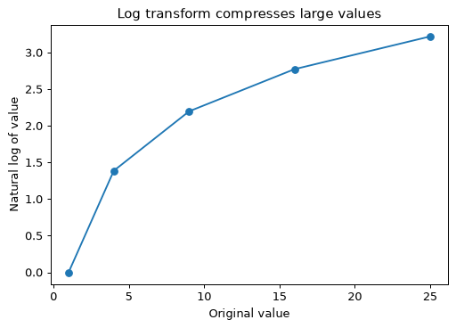

Engineering can go too far, though. Each new column is another chance to overfit, so a feature earns its place only when there is a reason to believe it carries information, not merely because it is possible.

Selection and engineering decide which columns exist, but not what scale they sit on, and two perfectly good features can sit on scales so different that one drowns the other. Removing that unfairness is what scaling is for.

## Scaling features

Age runs from about eighteen to sixty, and salary from twenty thousand to a hundred thousand. A method that judges closeness by straight line distance will let salary decide every distance, because its numbers are thousands of times larger, and age will be ignored. The size of a column's numbers should not decide its importance, so the features are put on a common footing.

Standardization subtracts the mean and divides by the standard deviation, giving a column with mean zero and standard deviation one, which keeps the shape, centres the values, and expresses them in units of standard deviations.

$$z = \frac{x - \mu}{\sigma}$$

Min max scaling subtracts the smallest value and divides by the range, so every value lands between zero and one. It is simple, but sensitive to outliers, because a single extreme value sets the range.

$$x' = \frac{x - \min(X)}{\max(X) - \min(X)}$$

Mean normalization subtracts the mean and divides by the range, centring the data near zero while keeping a bounded spread.

$$x' = \frac{x - \text{mean}(X)}{\max(X) - \min(X)}$$

All three are easy to see on one small feature.

```python
from sklearn.preprocessing import StandardScaler

f = pd.Series([1, 3, 5, 7, 9], dtype=float)
print((f - f.mean()) / f.std())          # standardized
print((f - f.min()) / (f.max() - f.min()))   # min-max
print((f - f.mean()) / (f.max() - f.min()))  # mean-normalized
```

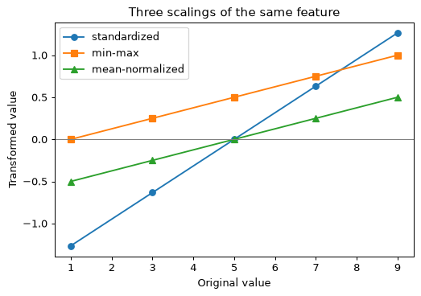

The feature's ends land at about minus and plus 1.26 under standardization, at zero and one under min max, and at minus and plus one half under mean normalization. The choice between them follows the model: distance based methods such as K nearest neighbours and support vector machines need standardization, bounded inputs such as image intensities are often min max scaled, and trees ignore scale altogether, which explains why some models tolerate raw features and others do not. One rule is absolute, the scaler is fitted on the training data only and then applied to the test data, never the reverse.

The groundwork is now in place: clean, scaled, chosen features and a clear target. At this point a single question decides the shape of everything that follows, and it is whether the answer is known for every row. If it is, the work is supervised learning, and the kind of answer decides which family of models applies.

## Supervised learning and the two kinds of target

Supervised learning is learning from labelled data. Each training row pairs inputs with the correct output, and the model's job is to find the mapping from inputs to output. The word supervised is deliberate, because every labelled row carries the correct answer and the model is checked against it. The crucial observation is that the nature of the output decides the family. When the output is a number on a continuous scale, such as a price or a temperature, the problem is regression. When the output is a category, such as yes or no, the problem is classification. The two use different algorithms and, just as importantly, different ways of measuring success.

The weather file makes the fork concrete. Predicting the humidity is regression, because humidity is a number, whereas predicting whether it will rain tomorrow is classification, because the answer is a category.

```python
df = load("Logistic_Regression_weatherAlbury.csv")
print(df[["Humidity3pm", "RainTomorrow"]].head())
```

The fork is not really about algorithms, which can sometimes be pressed into either role, but about the target and the metric. **Regression is judged by how far the predictions miss, and classification by how often the class is right, and confusing the two produces nonsense such as reporting an average error for a yes no prediction.**

Regression comes first, because it is the gentler introduction and its mathematics prepares the classification side. To predict a quantity a model of the relationship is needed, and the simplest model is a straight line. Before fitting one, it helps to say what makes a line good, which is the idea of a cost.

## Regression and the cost of a line

Regression models the relationship between a dependent variable and one or more independent variables, and the simplest case links one feature to the target with a straight line.

$$y = a_0 + a_1 x + \varepsilon$$

The intercept is where the line meets the vertical axis, the slope says how much the target changes for each unit of the feature, and the small error term stands for the variation no line can capture. Many lines could be drawn through a scatter of points, so a rule is needed for choosing among them. The natural rule is to pick the line whose total squared vertical distance from the points is smallest. Squaring rather than taking absolute values punishes large misses more than small ones and keeps the mathematics smooth, and the total being minimised is called the cost. Fitting the model means finding the intercept and slope that make this cost as small as possible.

Three things can ruin a regression, and their names are worth fixing early. An outlier is a point far from the rest, which can tilt the line. Multicollinearity is a strong correlation among the features, which muddles the slopes. And the two ways a model can fail to learn recur throughout the rest of the subject: underfitting is when the model is too simple to capture the pattern, and overfitting is when it memorises the training data and fails on anything new.

With the rule for a good line defined, the next step is to find it and to check it on data the model has not seen.

## Simple linear regression

With one feature and a continuous target, the goal is the line that best predicts the target and can be trusted on new data. Simple linear regression fits the line just described, using the same cost, except that the computer does the minimising. Because a line can be thrown off by seeing the same data twice, the file is split first and the line is learned from the training part only, then drawn over both parts to see whether it holds. The salary file, pairing years of experience with salary, is the natural setting.

```python
from sklearn.model_selection import train_test_split
from sklearn.linear_model import LinearRegression

df = load("Linear_Regression_Salary_Data.csv")
X = df.iloc[:, :-1].values
y = df.iloc[:, 1].values

X_train, X_test, y_train, y_test = train_test_split(
    X, y, test_size=0.2, random_state=0)

regressor = LinearRegression()
regressor.fit(X_train, y_train)
```

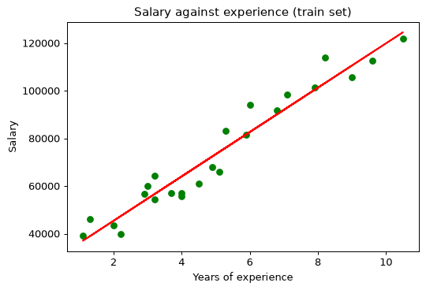

The training points sit close to the fitted line. Drawing the same line over the test points the model never saw checks whether the relationship generalises.

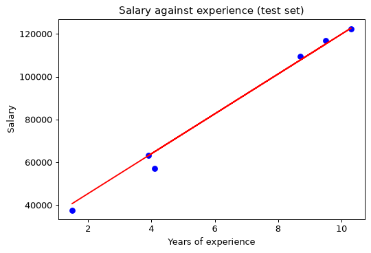

The fit is just as close on the test set, so the model has learned a real relationship rather than memorising.

```python
regressor.predict([[3.5]])   # about 59374 for three and a half years
```

The double brackets are not a typo: a model always expects a table of rows, even for a single row. The same method applies to any pair of quantities, and the weather file, pairing temperature with humidity, gives a second example.

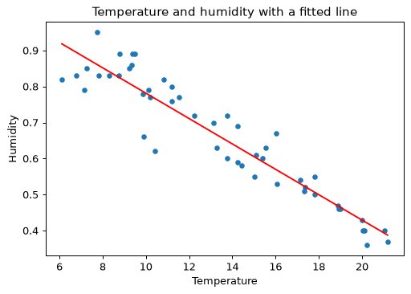

The line is gentler here, which is informative in itself, because it says the relationship is real but looser. A line like this has been judged by eye so far, and eye is not a measurement, so the next thing needed is a set of numbers that judge a regression.

## Measuring a regression

Two models can both draw a line and one is better, so a number is needed that says how good, and different numbers emphasise different things. Four scores cover most needs.

The mean absolute error averages the size of the misses and treats every miss equally.

$$\text{MAE} = \frac{1}{n}\sum |y_i - \hat{y}_i|$$

The mean squared error squares each miss before averaging, so it punishes large errors hardest, and it is preferred when big mistakes are especially costly.

$$\text{MSE} = \frac{1}{n}\sum (y_i - \hat{y}_i)^2$$

The root mean squared error takes the square root of the mean squared error, returning the result to the units of the target so it can be compared with the target's own size.

$$\text{RMSE} = \sqrt{\frac{1}{n}\sum (y_i - \hat{y}_i)^2}$$

And the coefficient of determination, written R squared, reports the fraction of the variation in the target that the model explains.

$$R^2 = 1 - \frac{\sum (y_i - \hat{y}_i)^2}{\sum (y_i - \bar{y})^2}$$

Scoring the salary model shows what these look like in practice.

```python
from sklearn import metrics

y_pred = regressor.predict(X_test)
print("Mean salary:", df["Salary"].mean())
print("RMSE:", np.sqrt(metrics.mean_squared_error(y_test, y_pred)))
print("R2 (%):", regressor.score(X_test, y_test) * 100)
```

The mean salary is about seventy six thousand, the root mean squared error about three thousand five hundred and eighty, and R squared about ninety nine percent. A useful rule of thumb is that an RMSE comfortably below ten percent of the target's mean signals a strong fit, and here it is far below. Reading the scores matters as much as computing them, though: an R squared of 0.9 sounds excellent, but a high R squared does not prove that one variable causes another, and it can be inflated by overfitting, so it should always be read beside an error score rather than instead of one.

One feature is rarely enough in practice, and when the target depends on several inputs a single line ignores most of them, which leads naturally to multiple regression.

## Multiple linear regression

Multiple linear regression extends the line to many features, each with its own coefficient that says how much that feature moves the target while the others are held fixed.

$$y = a_0 + a_1 x_1 + a_2 x_2 + \dots + a_n x_n + \varepsilon$$

The assumptions tighten: the relationship should be roughly linear, the features should not be badly collinear, and the errors should be symmetric and bell shaped. In return, the coefficients rank the features by their effect, which is often the real goal. The fifty companies file records what fifty startups spent on research, administration, and marketing, along with their state, and the profit each earned. State is a category, so it is encoded, and one dummy column is dropped to avoid the trap.

```python
from sklearn.preprocessing import LabelEncoder, OneHotEncoder
from sklearn.compose import ColumnTransformer

df = load("Multiple_Linear_Regression_50_CompList.csv")
X = df.iloc[:, :-1].values
y = df.iloc[:, 4].values

le = LabelEncoder()
X[:, 3] = le.fit_transform(X[:, 3])
ct = ColumnTransformer([("State", OneHotEncoder(), [3])], remainder="passthrough")
X = ct.fit_transform(X)
X = X[:, 1:]   # avoid the dummy variable trap

X_train, X_test, y_train, y_test = train_test_split(X, y, test_size=0.2, random_state=0)
regressor = LinearRegression().fit(X_train, y_train)
print("Test R2:", regressor.score(X_test, y_test))
```

The test score is about 0.93. To rank the features, each numeric column is correlated with profit.

```python
print(df.corr(numeric_only=True)["Profit"])
```

Research and development spend correlates with profit at about 0.97, marketing at about 0.75, and administration at only about 0.20, so one feature carries almost all the signal. Adding features is not automatically better, since each extra one is another chance to overfit and another source of collinearity, and a model with fewer, stronger features is easier to defend.

The line is now fitted to several features, but it is still straight, and some relationships curve. A straight line through a curve is confidently wrong, which is the problem the next idea solves.

## Polynomial regression

Some relationships are not straight. Salaries rise slowly through the junior levels and then leap at the top, and a line misses that shape at exactly the part that matters. Polynomial regression adds powers of the feature as extra columns, so the model can bend.

$$y = a_0 + a_1 x + a_2 x^2 + a_3 x^3 + \dots$$

The name is confusing at first, because the model is still linear in its coefficients; it is a linear regression that happens to be fed curved features. The highest power is the degree, a value chosen rather than learned. Too small a degree underfits and misses the curve, and too large a degree overfits and wiggles through the noise. The position salaries file, pairing a job level with a salary, shows the difference.

```python
from sklearn.preprocessing import PolynomialFeatures

pos = load("Polynomial_Regression_Position_Salaries.csv")
Xp = pos.iloc[:, 1:2].values
yp = pos.iloc[:, 2].values

poly = PolynomialFeatures(degree=2)
model = LinearRegression().fit(poly.fit_transform(Xp), yp)
```

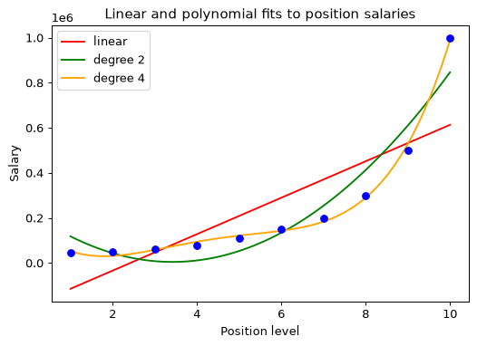

The straight line misses the top of the curve, while the degree two and degree four curves follow the rise. The feature expansion is easy to see by hand: a value of six becomes a row of one, six, and thirty six, because the constant, the first power, and the square are now separate columns. Higher degree is not better, and the right degree is the smallest that captures the shape, found by trying a few and comparing their test scores and watching for the moment a score improves on training but stops improving on test, which is the signature of overfitting.

This finishes the regression side, where every model predicted a number. The moment the target becomes a category rather than a quantity, a straight line is the wrong tool, because it ranges over all numbers while the answer has only a few possible values, and that is where classification begins.

## Classification and its measures

Classification predicts which category an observation belongs to. With two categories it is called binary classification, and with more it is multi class. In a spam filter, a medical screen, or a face detector, the output is a label, and the question is not how far off a prediction was but whether the class was right.

Accuracy alone can badly mislead, so the confusion matrix records four counts for a binary problem: the true positives and true negatives where the model was right, and the false positives and false negatives where it was wrong. From these come precision, the share of positive predictions that were correct, and recall, the share of real positives that were found.

$$\text{Precision} = \frac{TP}{TP + FP} \qquad \text{Recall} = \frac{TP}{TP + FN}$$

A filter that flagged one hundred and ten messages, of which ninety were truly spam and twenty were not, while failing to catch thirty real spam messages, has a precision of about 0.82 and a recall of about 0.75. Whether it should be tuned to favour one over the other depends on the cost of each kind of mistake. When both matter, the F1 score balances them into a single number.

$$F_1 = 2 \cdot \frac{\text{precision} \cdot \text{recall}}{\text{precision} + \text{recall}}$$

Two further tools complete the picture. The receiver operating characteristic curve plots the true positive rate against the false positive rate as the threshold moves, and the area under it summarises how well the model separates the classes at every threshold. Log loss scores the probabilities the model assigns and rewards confident, correct probabilities.

Every classification method must turn features into a class, and the closest one to regression is the method that first predicts a probability and then applies a threshold, so that is where the branch begins.

## Logistic regression

A probability between zero and one is wanted, but a linear model ranges over all real numbers, so the straight line is bent so that it can only produce values in the allowed range. The bend is the logistic function, also called the sigmoid, which squeezes any number into the range zero to one.

$$\sigma(z) = \frac{1}{1 + e^{-z}}, \qquad z = a_0 + a_1 x_1 + \dots + a_n x_n$$

Large positive values of z push the output towards one, large negative values push it towards zero, and z of zero gives one half. A threshold, usually one half, then turns the probability into a class, and the coefficients say how each feature shifts the likelihood. The diabetes file, which records eight clinical measurements and whether each patient is diabetic, is a good test. It has no header row, so its columns are named by hand.

```python
col_names = ["pregnant", "glucose", "bp", "skin", "insulin",
             "bmi", "pedigree", "age", "label"]
df = pd.read_csv(DATA / "Logistic_Regression_pima-indians-diabetes.csv",
                 header=None, names=col_names)

X = df[col_names[:-1]]
y = df["label"]
X_train, X_test, y_train, y_test = train_test_split(X, y, test_size=0.25, random_state=0)

from sklearn.linear_model import LogisticRegression
logreg = LogisticRegression(solver="lbfgs", max_iter=1000).fit(X_train, y_train)
print("Accuracy:", metrics.accuracy_score(y_test, logreg.predict(X_test)))
```

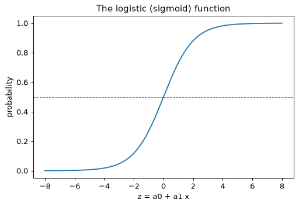

The accuracy is about eighty percent, and a single patient can be predicted in the same way as before.

```python
print(logreg.predict([[6, 148, 72, 35, 0, 33.6, 0.627, 50]]))
```

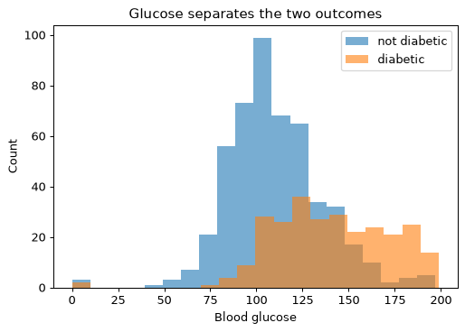

The histogram shows why glucose carries the signal, since the diabetic readings sit higher than the rest. The model comes in three flavours, binomial for two classes, multinomial for several unordered classes, and ordinal for ordered classes, and it assumes the classes are separated by a fairly simple boundary in the feature space. When that boundary is not simple the model underfits, which is exactly the limit the next method removes.

## K nearest neighbours

A single global boundary may not fit the data, and sometimes the right answer depends on the neighbourhood of a point rather than on a rule that holds everywhere. K nearest neighbours follows that instinct literally: it stores all the training data and, to label a new point, finds the k training points closest to it and lets them vote. There is no equation and no coefficients to learn, which is why it is called a lazy learner. The distance is usually the straight line, or Euclidean, distance.

$$d(p, q) = \sqrt{(p_1 - q_1)^2 + (p_2 - q_2)^2 + \dots + (p_n - q_n)^2}$$

The customer file, which gives age, salary, and a purchase outcome, makes a clean two dimensional example.

```python
from sklearn.preprocessing import StandardScaler
from sklearn.neighbors import KNeighborsClassifier

df = load("Naive_Bayes_Decision_RF_Tree_Boosting_User_Data.csv")
X = df.iloc[:, [2, 3]].values
y = df.iloc[:, 4].values
X_train, X_test, y_train, y_test = train_test_split(X, y, test_size=0.25, random_state=0)

scaler = StandardScaler()
X_train = scaler.fit_transform(X_train)
X_test = scaler.transform(X_test)

knn = KNeighborsClassifier(n_neighbors=5, metric="minkowski", p=2).fit(X_train, y_train)
print("Accuracy:", accuracy_score(y_test, knn.predict(X_test)))
```

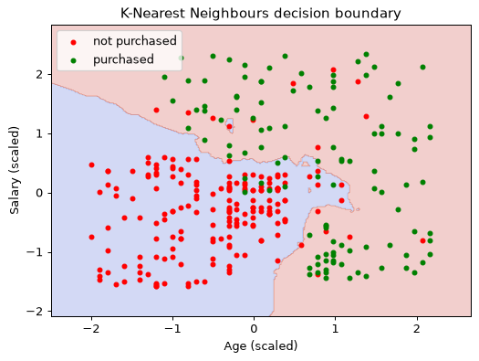

The shaded regions show where each class is predicted, and the accuracy is about ninety three percent, the highest so far. The value of k is the main lever: a very small k is noisy and lets a single stray point decide, while a very large k smooths away real detail, so five is a common starting point and an odd number avoids ties. Because the method is built entirely on distances, scaling is not optional, and because every prediction compares the new point with every stored point, it grows slow as the data grows. That cost is the weakness the next method addresses.

## Support vector machines

Many boundaries can separate two classes, and most of them sit so close to the points that a new example could fall on the wrong side. A support vector machine chooses the boundary that leaves the widest margin, the empty strip between the classes, which in two dimensions is a line. The training points sitting on the edges of the strip are the support vectors, because they alone fix where the boundary lies, and the rest could be removed without changing it. When the classes cannot be separated by a straight line, a kernel lets the machine work in a richer space where they can, without ever writing down the extra coordinates.

```python
from sklearn.svm import SVC

svm = SVC(kernel="linear", random_state=0).fit(X_train, y_train)
print("Accuracy:", accuracy_score(y_test, svm.predict(X_test)))
```

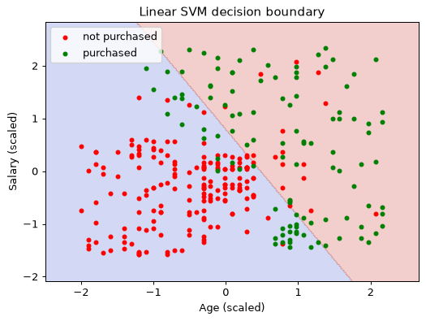

The accuracy is about ninety percent, and the boundary carves up the space very differently from the one K nearest neighbours drew. The kernel is the main lever: a linear kernel draws a straight boundary, a polynomial kernel a curved one, and a radial basis kernel a local one, so the method can be tuned to the shape of the data. Like K nearest neighbours it depends on distances, so scaling is required. One caution is that a support vector machine does not naturally return a probability, only a decision, which is a limit the next method does not share.

## Naive Bayes

Some classifiers give a decision but not a clear account of confidence, so a route that reasons about probabilities directly is worth having, especially one that stays fast when there are many features. Naive Bayes updates a belief in light of evidence using Bayes' theorem.

$$P(A \mid B) = \frac{P(B \mid A) \, P(A)}{P(B)}$$

The term P of A is the prior, what was believed before the evidence. P of B given A is the likelihood, how probable the evidence is if the belief is true. P of B is the overall probability of the evidence, and the result is the posterior, the updated belief. The method is called naive because it assumes the features are independent, which is rarely exactly true but usually good enough.

The classic weather example uses a small table of past days. Frequency counts are built, converted to likelihoods, and the theorem is applied to answer whether to play on a sunny day. The probability of playing comes out near 0.60 against about 0.41 for not playing, so the model plays. The Gaussian version, which assumes each feature is a bell shape, then works on the customer data.

```python
from sklearn.naive_bayes import GaussianNB

nb = GaussianNB().fit(X_train, y_train)
print("Accuracy:", accuracy_score(y_test, nb.predict(X_test)))
```

The accuracy is about ninety percent. The three variants fit different kinds of data: the Gaussian model suits continuous features, while the multinomial and Bernoulli models use word counts and word presence respectively and suit text. Naive Bayes is fast and works well with many features, which is why it is a favourite for spam filtering, but its independence assumption means it can be badly wrong when features are strongly related.

Naive Bayes assumes independence and produces a simple boundary. A decision tree makes a different trade, assuming nothing of the kind and explaining its reasoning as a sequence of questions that anyone can follow.

## Decision trees

A decision tree asks a sequence of questions. Each internal node tests one feature, each branch is the outcome of that test, and each leaf gives the class. The tree is grown by choosing, at each node, the question that best separates the classes. Two measures guide that choice. Entropy measures the disorder of the labels, highest when the classes are mixed and zero when a node is pure.

$$\text{Entropy}(S) = -p_{\text{yes}} \log_2 p_{\text{yes}} - p_{\text{no}} \log_2 p_{\text{no}}$$

Information gain is the entropy before a split minus the weighted entropy after, and the tree prefers the feature with the largest gain. The Gini index is the alternative used by the CART algorithm, measuring impurity without logarithms.

```python
from sklearn.tree import DecisionTreeClassifier, plot_tree

dt = DecisionTreeClassifier(criterion="entropy", random_state=0).fit(X_train, y_train)
print("Accuracy:", accuracy_score(y_test, dt.predict(X_test)))

small = DecisionTreeClassifier(criterion="entropy", random_state=0,
                               max_depth=3).fit(X_train, y_train)
```

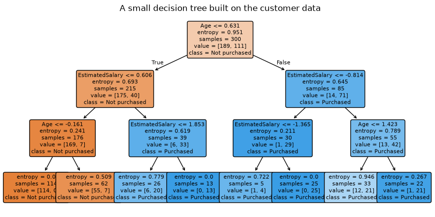

The shallow tree asks about salary first, then about age, and reaches a decision within a few questions, which is the whole appeal of trees. The levers are the criterion, entropy or Gini, and the depth, which controls overfitting; a tree grown without limit memorises the training data and collapses on anything new, so pruning is often necessary. The deeper weakness is instability, because a small change in the data can produce a very different tree and a different accuracy, so a single tree is unreliable on its own. That weakness is what the next idea repairs.

## Ensembles: random forests and boosting

An ensemble combines many models so that their errors cancel while their shared signal survives, which cures the fragility of a single tree without giving up its accuracy. Random forests use bagging: each tree is trained on a random sample of rows drawn with replacement, and at each split it may consider only a random subset of features, so the trees differ, and their predictions are then voted or averaged. Boosting works differently, training models in sequence, each one focusing on the examples the previous ones got wrong. In AdaBoost, many small stumps are weighted, with more weight on the hard rows, and the final prediction is a weighted vote. Gradient boosting reframes the same idea as optimisation, fitting each new tree to the remaining errors and adding it with a weight chosen to reduce the loss, so the name comes from following the slope of the loss downhill. XGBoost is a fast, well engineered form of gradient boosting.

```python
from sklearn.ensemble import RandomForestClassifier, AdaBoostClassifier, GradientBoostingClassifier

rf = RandomForestClassifier(n_estimators=10, criterion="entropy", random_state=0)
ada = AdaBoostClassifier(n_estimators=50, learning_rate=0.1, random_state=0)
gb = GradientBoostingClassifier(random_state=0)
for name, model in [("forest", rf), ("adaboost", ada), ("gradient", gb)]:
    model.fit(X_train, y_train)
    print(name, accuracy_score(y_test, model.predict(X_test)))
```

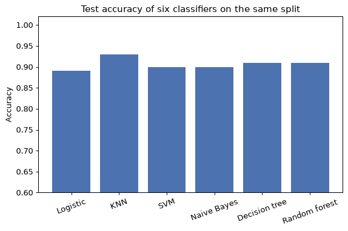

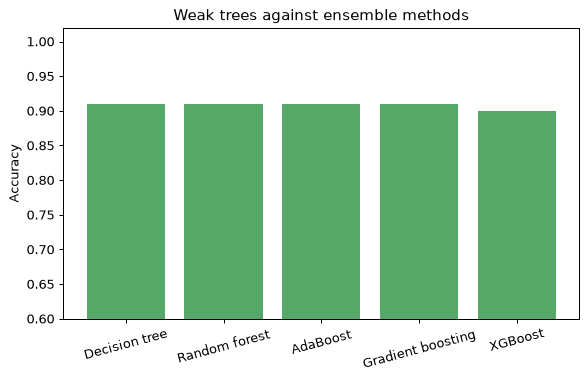

On this easy problem the models cluster together, which is itself informative: once the signal is clear, many good methods find it, and the choice among them falls to speed, convenience, and how gracefully each handles messier data. The main levers are the number of trees and, for boosting, the learning rate, which controls how much each new model is allowed to correct; a small learning rate with many trees is slower but often more accurate. The distinction between bagging and boosting is easy to confuse, so it is worth stating plainly: bagging trains in parallel on different samples and averages, while boosting trains in sequence on the mistakes and is more sensitive to noisy data.

The supervised toolbox is now rich, but the examples have used only two features. Real tables often have dozens or hundreds of columns, and too many features cause overfitting and collinearity, so before leaving supervised learning it is worth learning how to cut them down.

## Reducing features: backward elimination and PCA

More features are not better. Extra columns add complexity, invite overfitting, create collinearity, and make a model harder to explain, so principled ways are needed to keep only what earns its place, or to compress what is partly redundant. Two methods answer two versions of the question.

Backward elimination keeps the features that are statistically significant. The model is fitted with all features, each one's p-value is read, and the p-value measures how likely an effect that large is under the assumption that the feature does nothing. The feature with the largest p-value is removed if it exceeds a significance level such as 0.05, the model is refitted, and the process repeats until every remaining feature is significant. The companies data shows the effect.

```python
import statsmodels.api as sm

X_new = np.append(np.ones((50, 1)).astype(int), X, axis=1)
x_opt = X_new[:, [0, 1, 2, 3, 4, 5]].astype("float")
print(sm.OLS(endog=y, exog=x_opt).fit().summary())
```

The column of ones carries the intercept. Reading the p-values, both state dummies fall away, then administration spend, then marketing spend, until only research and development spend remains, and a model built on that single feature actually scores slightly higher, about 0.945 on the test set against 0.935 with all four features.

Principal component analysis takes the other route. Rather than choosing among the original features, it builds new ones, finding the directions along which the data varies most, called principal components, which are uncorrelated with each other, and keeping the first few if they explain most of the variation. The mathematics rests on eigenvalues and eigenvectors: the eigenvectors of the data's correlation matrix are the component directions, and the eigenvalues are how much variance each explains. The wine data, with thirteen chemical measurements, shows the compression.

```python
from sklearn.decomposition import PCA
```

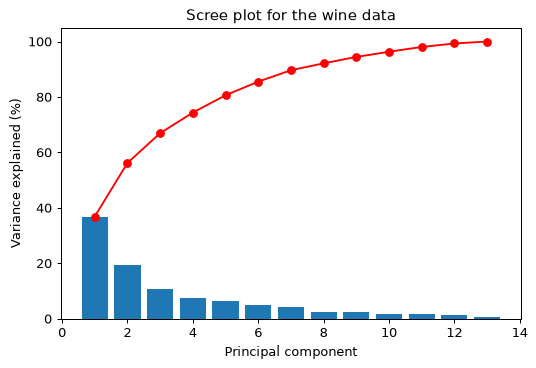

The first component explains about thirty seven percent of the variance and the second about nineteen, so two together explain roughly fifty six percent.

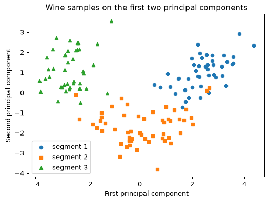

With those two components, a logistic regression still reaches about ninety seven percent accuracy, so two measurements do almost the work of thirteen. The discipline is to reduce gradually: for PCA, halve the dimension, check the accuracy, then step down one at a time, stopping when the accuracy becomes unacceptable, rather than jumping to a very small number and blaming the data. For backward elimination, p-values are only as trustworthy as the model's assumptions.

Every model so far has needed labels, because each one was taught with an answer key. Labels are expensive and often absent, though, and that single fact is the largest constraint in the field, which is where the subject turns.

## Clustering without labels

Sometimes there is a table of customers but no column saying what kind of customer each one is, so there is no answer key, and supervised learning has nothing to learn from because it depends on comparing predictions with correct answers. The data may still hold structure worth finding, and finding it without labels is unsupervised learning. This is the constraint that separates the two halves of the subject: supervised learning maps inputs to known outputs, while unsupervised learning finds structure in inputs alone.

Hierarchical clustering is the gentlest introduction. It begins by treating every point as its own cluster and repeatedly merges the two closest, recording every merge in a tree shaped diagram called a dendrogram. The height at which two groups join is the distance at which they merged, and to choose the number of clusters the dendrogram is cut horizontally, so that the branches below the cut are the clusters. What counts as the distance between clusters is set by a linkage rule, such as single for the closest pair, complete for the farthest, average for the average, or Ward's method, which merges the pair that adds least to the total within cluster variance. The mall customers, whose income and spending score make a clear two dimensional picture, are a good example, and their few missing rows are dropped first.

```python
import scipy.cluster.hierarchy as shc

df = load("Mall_Customers_Clustering.csv").dropna()
X = df.iloc[:, [3, 4]].values
shc.dendrogram(shc.linkage(X, method="ward"))
plt.show()
```

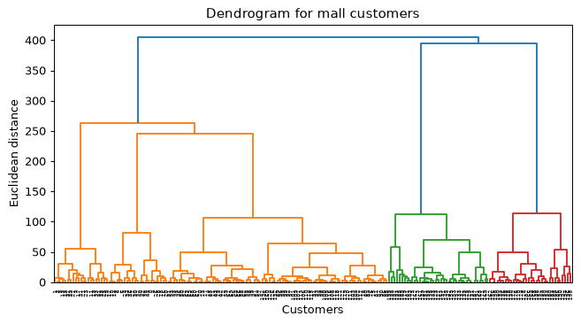

The long vertical stretches should not be cut through, and a horizontal cut across the longest vertical gap gives the clusters, which shows that clustering has no single right answer, only a defensible one. The linkage method is the main lever, and different methods give different clusters, so trying more than one is worthwhile. The great advantage of hierarchical clustering is that no cluster count has to be fixed in advance, which is exactly the freedom that the next method lacks.

## K-means and choosing the number of clusters

Often a single, fast method aimed at a chosen number of groups is wanted, and that is K-means. The number of clusters, K, is chosen, K centroids are placed, every point is assigned to its nearest centroid, each centroid is recomputed as the average of its points, and the steps repeat until the assignments stop changing. The quantity being minimised is the within cluster sum of squares, the total squared distance from each point to its own centroid.

$$\text{WCSS} = \sum_{\text{clusters}} \sum_{\text{points}} \lVert p - c \rVert^2$$

Because K must be chosen beforehand, the elbow method is used to find it. K-means is fitted for a range of K, the within cluster sum of squares is recorded each time, and it is plotted against K, where the curve falls steeply and then flattens, and the bend that looks like an elbow is the natural number of clusters.

```python
from sklearn.cluster import KMeans

wcss = []
for k in range(1, 11):
    km = KMeans(n_clusters=k, init="k-means++", random_state=42, n_init=10).fit(X)
    wcss.append(km.inertia_)
plt.plot(range(1, 11), wcss, "o-"); plt.show()
```

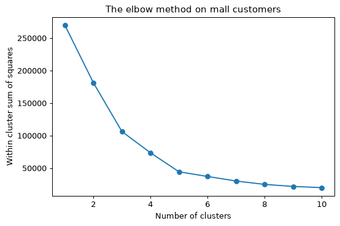

The values fall from about two hundred and seventy thousand at one cluster to about twenty thousand at ten, and the last steep drop is between four and five, so five is chosen.

```python
km = KMeans(n_clusters=5, init="k-means++", random_state=42, n_init=10)
labels = km.fit_predict(X)
```

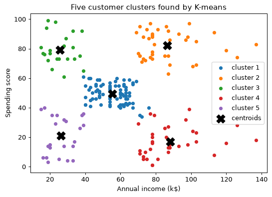

The five groups are separated by income and spending, which is exactly the kind of segmentation a shop would act on. The weaknesses are worth stating plainly: K-means prefers clusters that are round and of similar size, so it struggles with long or curved clusters, the result depends on where the centroids start, which is why the k-means plus plus initialisation is used, and the elbow is a judgement rather than a rule, so a slightly different K can be defensible.

Clustering groups rows by similarity, which answers one kind of question but not another, namely which items tend to appear together. A shopper buying bread is not asking to be grouped with other shoppers, and the useful fact is that bread and butter travel together, which needs a different tool.

## Association rules

In a shop the goal is often to know which products are bought together, so that they can be placed side by side or recommended one after the other. Association rule mining finds items that co occur in transactions and expresses the finding as a rule, such as bread implying butter, and three numbers judge each rule.

Support is how often the items appear together across all transactions.

$$\text{support}(A) = \frac{\text{transactions containing } A}{\text{total transactions}}$$

Confidence is the share of the antecedent's transactions that also contain the consequent.

$$\text{confidence}(A \to C) = \frac{\text{support}(A \cup C)}{\text{support}(A)}$$

Lift compares the confidence with how often the consequent appears on its own, so a lift above one means the antecedent genuinely makes the consequent more likely. The Apriori algorithm exploits the fact that if an item set is frequent then all of its subsets must be frequent, which lets it discard huge numbers of candidates instead of testing every combination.

No transaction file ships with these notes, so a small basket log stands in for one, and it shows the whole procedure.

```python
from apyori import apriori

records = [["bread", "butter"],
           ["bread", "butter", "jam"],
           ["bread", "butter"],
           ["bread", "butter"],
           ["bread", "butter", "jam"],
           ["milk"]]

rules = list(apriori(records, min_support=0.3,
                     min_confidence=0.6, min_lift=1.1, min_length=2))
for rule in rules:
    print(list(rule.items), "support:", round(rule.support, 3))
```

Bread and butter appear together in five of the six baskets, so the rule joining them clears every threshold and shows a lift above one. The pruning happens round by round: single items are counted and kept if frequent, frequent singles are combined into pairs, which are counted and kept if frequent, frequent pairs are combined into triples, and the process continues until no larger set survives. The thresholds are the levers, and too high a support leaves nothing while too low a support floods the output with weak rules, so lift, rather than support or confidence alone, is the best guard against spurious rules, because it removes pairs that only co occur by chance.

Both supervised and unsupervised learning assume that the data already exists, gathered in advance, which is not always true. A robot must act to gather its own experience, and it learns from the rewards its actions earn, which is the last idea in the subject.

## Reinforcement learning

Sometimes there is no dataset at all. A game playing program cannot be given a table of every position and the correct move, because the correct move depends on what happens next, which depends on the opponent, so it must act, observe the consequences, and improve from the results without ever being told the right move. Reinforcement learning is learning from feedback: an agent interacts with an environment, takes actions, and receives a reward for good actions and a penalty for bad ones, and its goal is to maximise the total reward over time. It explores the environment, learns which actions pay off in which situations, and improves its behaviour. This is the setting behind game playing programs and control systems such as a robot learning to walk, and it differs from everything before it because the data is generated by the agent's own actions rather than gathered in advance.

A game is the clearest illustration. Each position is a situation, each legal move is an action, and the reward is plus one for a win and minus one for a loss, perhaps only at the very end, which is what makes the problem hard, because the agent must work out which of its earlier moves deserve credit for the final result. That credit assignment problem is the heart of the topic, and it gives the right intuition even without the mathematics. The main levers are how much the agent explores versus exploits what it already knows, and how it balances immediate reward against long term reward; too much exploration wastes time, and too much exploitation misses better strategies.

## Pulling it together

Seen as a whole, the subject is one argument held together by constraints. Tasks that could not be programmed by rule were met by learning from data. Data arrived dirty and on mixed scales, so it was cleaned and scaled. Too many or too few features hurt, so they were selected, engineered, and reduced. The first great branch followed from the target, where a number meant regression and a category meant classification, and logistic regression was the hinge between them. Within regression the work moved from one feature to many to curves, each step forced by the previous model's limits. Within classification it moved from a global boundary to a local one, then to the widest margin, then to probabilities, then to questions, then to ensembles that cure a single tree's instability. The second great branch followed from the absence of labels, which led to clustering and association, and finally to reinforcement learning, where there is no dataset at all until the agent acts.

Every idea earned its place by naming a problem the previous tools could not solve. Kept in view, those constraints turn a list of algorithms into a single line of reasoning that keeps answering the question of what to do when the last idea is not enough.
