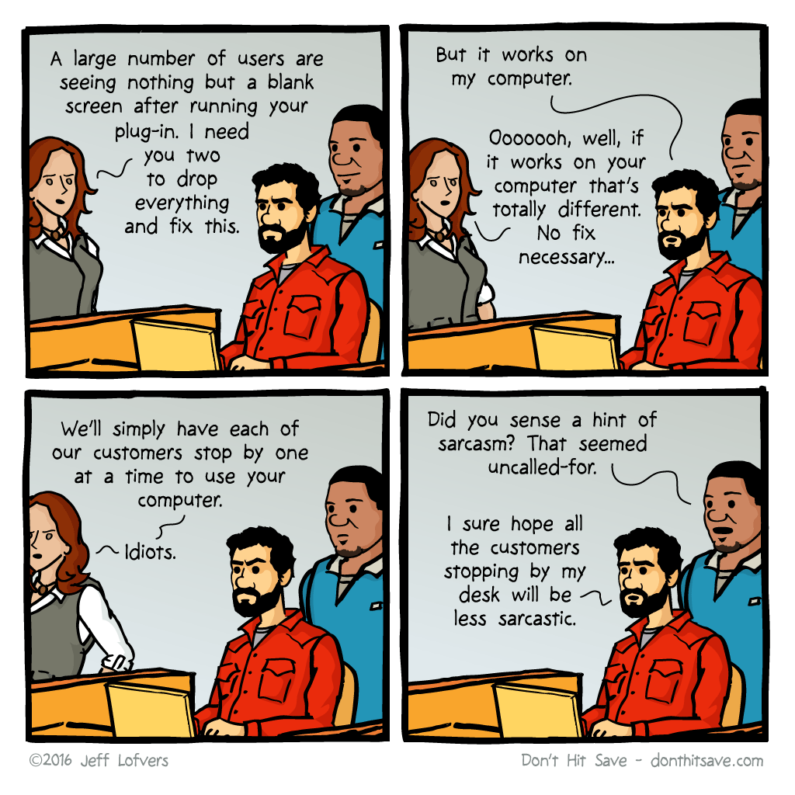
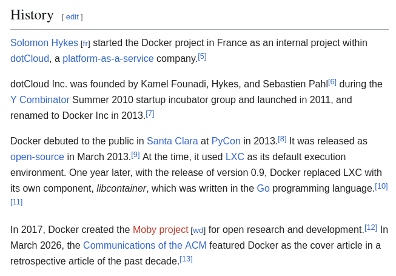
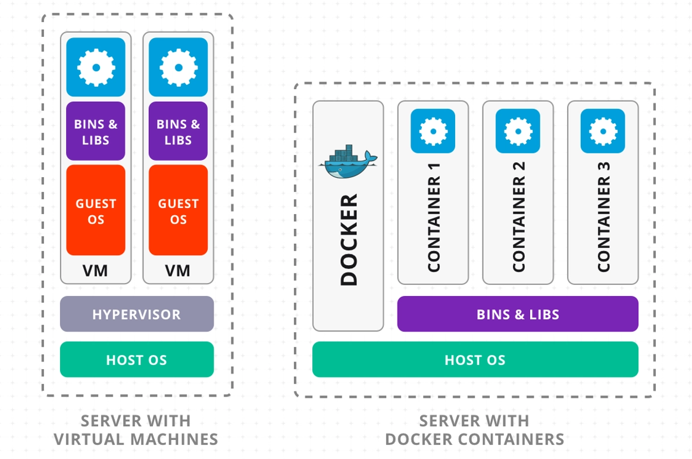
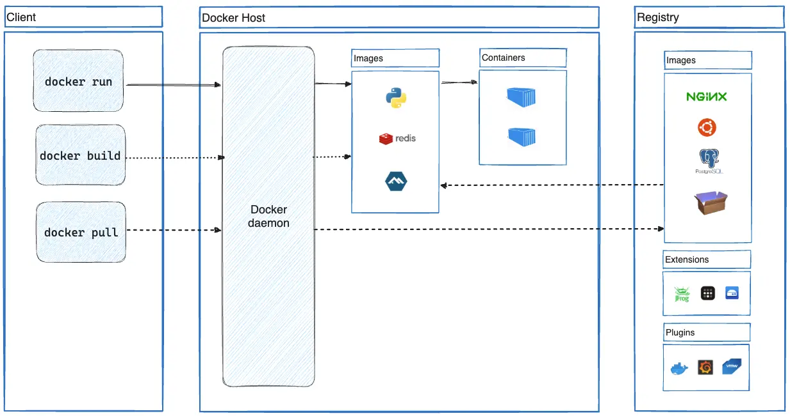

# Docker

**Docker** is a set of products that uses [operating system-level virtualization](https://en.wikipedia.org/wiki/Operating_system-level_virtualization "Operating system-level virtualization") to deliver software in packages called _[containers](https://en.wikipedia.org/wiki/Containerization_\(computing\) "Containerization (computing)")_. Docker automates the deployment of [applications](https://en.wikipedia.org/wiki/Application_software "Application software") within lightweight containers, enabling them to run consistently across different computing environments. [Wikipedia](https://en.wikipedia.org/wiki/Docker_(software))

Docker is not just a tool/technology. It is a company under [yc](https://www.ycombinator.com/). 

Docker is not sole containerization technology. We have `Podman`, which is a rootless, deamonless architecture. So for the sake of knowing containerization, we will be studying docker.

Idea of containers came from;

> **Note**
> "It works on my machine." ---> everyone, right before deployment.

Scenerio; your app have it's own dependency. For example, your nodejs/python backend project, there are specific libraries, OS tweaks to make it run. That means, the entire organization must need the same set of libraries and configurations like yours. That fragile web of "you need exactly this to run" is the **Matrix from Hell**.

Docker fixes it. It containerize the source, dependency into a image that everyone can run on every machine respective of their operating system.

### Isolation

Isolation can be on three architecture. Bare metal, virtual machine, and containers.

Bare metal refers to a single operating system that runs everything directly on the hardware; in this setup, applications compete for the same resources and libraries, so a single faulty dependency can cause the entire system to fail. 

Virtual machines, by contrast, rely on a hypervisor to virtualize the hardware, allowing each VM to carry its own full guest‑OS kernel. This provides strong isolation, but it is heavyweight: a VM can take a minute to start and consume gigabytes of RAM. Containers take a different approach by virtualizing only the OS layer rather than the hardware. All containers share the host’s single Linux kernel and make use of two built‑in Linux features to achieve isolation and resource control. This model offers lighter weight, faster startup, and more efficient use of memory compared with full virtual machines, while still keeping applications separated from one another.

### Core Terminology

- **Dockerfile**: Lists the base OS, dependencies, and the command to run.
- **Image**: the compiled, **read-only** snapshot built from the recipe. Immutable. Think *class*.
- **Container**: a **running instance** of an image, with a thin writable layer on top. Think *object*.
- **Registry / Docker Hub**: the store where versioned images are pushed and pulled from.

[Docker Hub](https://hub.docker.com/)

### Working

Before touching the CLI, know these three things:
1. **Client–Server model**: the `docker` command you type is just a client. It sends requests to a background **daemon (`dockerd`)**, which does the real work.
2. **Image vs. Container**: a frozen blueprint vs. a live, running instance of it.
3. **Union File System (layers)**: images are stacked **read-only layers**. If a layer hasn't changed, Docker reuses it instantly, that's why builds and downloads are fast and cached.

#### Monolith vs. Containerized Services

When a single server takes in frontend, backend, and database into a single machine it comes with a heavy risk. One failure on this system result in the entire app being a failed thread.

Better way: **decouple** each piece into its own container. A classic three-tier app becomes:
- Web server container
- App/API container
- Database container

[Walmart](walmart.com)

> Microservices are the *architecture*; containers are just the *packaging and runtime*. Not the same thing.

### Stateless vs. Stateful

Containers are **ephemeral**, that is, once we delete it, and anything written inside vanishes.
- **Stateless (web/app servers):** perfect fit. Trash it, spin up a fresh one, no harm.
- **Stateful (databases):** can run in containers, but need **volumes**, persistent storage mounted from outside the container so data survives.